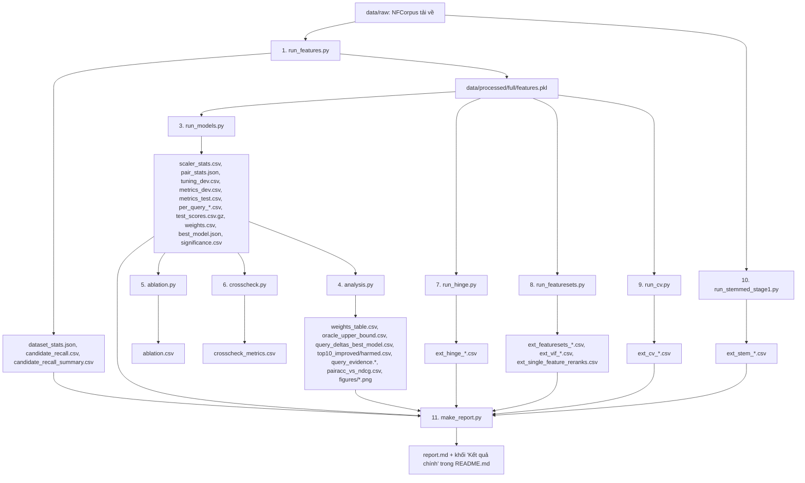

# Bản đồ file của dự án

> **Bạn cần nhớ:** Dự án gồm: **dữ liệu** (`data/`) → **mã nguồn** (`src/`) → **kết quả** (`results/`) → **báo cáo** (`report.md`). Chỉ cần chạy `run_all.sh` là tạo lại tất cả từ dữ liệu gốc.

---

## 2.1 Mọi file và thư mục ở cấp trên cùng

> **Bạn cần nhớ:** `src/` là mã, `results/` là kết quả, `report.md` là báo cáo, `docs_vi/` là tài liệu học.

| Mục | Là gì | Bạn dùng khi nào |
|---|---|---|
| `README.md` | trang giới thiệu, lệnh chạy, bảng bố cục file, "Kết quả chính" (tự sinh) | đọc đầu tiên |
| `report.md` | báo cáo đầy đủ bằng tiếng Anh: dữ liệu, phương pháp, kết quả, kiểm định, phân tích, mở rộng (mục 9, 10) | khi cần chi tiết/bằng chứng |
| `run_all.sh` | một lệnh dựng lại mọi thứ từ dữ liệu gốc | khi chạy lại |
| `environment.yml` | danh sách thư viện (môi trường conda) | khi cài môi trường |
| `src/` | toàn bộ mã nguồn (mô-đun hóa) | khi đọc code |
| `tests/` | kiểm thử tự động (pytest) | khi muốn biết cái gì được kiểm tra |
| `results/` | mọi file kết quả sinh ra (CSV, JSON, biểu đồ, log) | khi cần số liệu |
| `data/` | dữ liệu gốc tải về (`data/raw/`) và cache đặc trưng (`data/processed/`) | hiếm khi |
| `docs_vi/` | bộ tài liệu tiếng Việt này (+ công cụ dựng/kiểm tra số) | để học |
| `Chap_8.pdf`, `Programming_Exercises.pdf` | slide Chương 8 và đề bài của khóa học | tham chiếu đề |
| `results_smoke/` | kết quả của lần chạy thử nhanh (`--smoke`) trên tập con nhỏ; **không dùng làm kết quả chính** | bỏ qua |
| `.pytest_cache/` | bộ nhớ đệm của pytest | bỏ qua |

---

## 2.2 Sơ đồ đường ống: từ dữ liệu gốc đến `report.md`

> **Bạn cần nhớ:** Dữ liệu đi qua một chuỗi bước từ `run_features.py` đến `make_report.py`; mỗi bước ghi ra một nhóm file trong `results/`.



Phiên bản chữ (ASCII):

```
dữ liệu gốc (data/raw)
   |
   v
[1] run_features.py  -> features.pkl, dataset_stats.json, candidate_recall*.csv
   |
   v
[2] pytest tests      (kiểm thử tự động)
   |
   v
[3] run_models.py    -> tuning_dev, metrics_dev/test, per_query_*, test_scores, weights, significance, best_model
   |
   +--> [4] analysis.py   -> weights_table, query_*, top10_*, pairacc_vs_ndcg, figures
   +--> [5] ablation.py   -> ablation.csv
   +--> [6] crosscheck.py -> crosscheck_metrics.csv
   |
   +--> [7] run_hinge.py        -> ext_hinge_*        (hinge chuẩn)
   +--> [8] run_featuresets.py  -> ext_featuresets_*  (v1 / v1 rút gọn / v2)
   +--> [9] run_cv.py           -> ext_cv_*           (kiểm định chéo 5 phần)
   +--> [10] run_stemmed_stage1.py -> ext_stem_*      (tầng 1 có stemming)
   |
   v
[11] make_report.py -> report.md (+ README "Kết quả chính")
```

Nhật ký chạy và thời gian tổng ghi ở `run_log.txt` và `total_runtime_seconds.txt`.

---

## 2.3 Mỗi file trong `src/`

> **Bạn cần nhớ:** Mỗi file trong `src/` có đúng một việc; ba file cốt lõi là `pairs.py`, `models.py`, `metrics.py`.

Cách đọc bảng: **Vào** = dữ liệu đầu vào; **Ra** = thứ nó sinh ra; **Hàm quan trọng** = 2-3 hàm nên đọc.

### Nền tảng

| File | Mục đích | Vào → Ra | Hàm quan trọng |
|---|---|---|---|
| `config.py` | mọi hằng số: hạt giống, số ứng viên, tham số BM25, lưới C, ngân sách bộ nhớ, giới hạn cặp/truy vấn | → hằng số cho mọi file khác | các hằng `SEED`, `TOP_K`, `C_GRID`, `PAIR_CAP_PER_QUERY` |
| `data.py` | tải NFCorpus, nạp dữ liệu và nhãn, thống kê, bảo vệ chia theo truy vấn | file gốc → danh sách tài liệu, truy vấn, nhãn | `download()`, `load()`, `assert_query_disjoint()` |
| `util.py` | thư mục đầu ra, ghi log, thông tin môi trường | → thư mục `results/`, `run_log.txt` | `dirs()`, `Logger`, `env_info()` |

### Tầng 1 và đặc trưng

| File | Mục đích | Vào → Ra | Hàm quan trọng |
|---|---|---|---|
| `bm25.py` | BM25 và TF-IDF tự cài đặt trên ma trận thưa | văn bản → ma trận trọng số, điểm | `tokenize()`, `bm25_weight_matrix()`, `top_k()` |
| `features.py` | chọn Top-100 bằng BM25 và tính [[count|weights_table.csv||d]] đặc trưng (không dùng nhãn) | tài liệu + truy vấn → bảng đặc trưng | `TextIndex`, `stage1_and_features()` |
| `porter.py` | bộ stemmer Porter tự viết | từ → từ gốc | `stem()` |
| `features_v2.py` | thêm 5 đặc trưng v2 (BM25 stemming, bigram, khoảng cách từ, BM25 k1=2/b=0.5) | bảng ứng viên → cột mới | `compute_v2_new()`, `proximity()`, `bigrams()` |
| `stage1_eval.py` | bộ phân tích có stemming; tóm tắt recall và giới hạn trên (oracle) | bảng ứng viên → bảng tóm tắt | `stem_analyzer()`, `recall_summary()`, `oracle_and_stage1()` |

### Huấn luyện và đánh giá

| File | Mục đích | Vào → Ra | Hàm quan trọng |
|---|---|---|---|
| `pairs.py` | tạo cặp ưu tiên trong cùng truy vấn, cân bằng hướng, lấy mẫu, ước lượng bộ nhớ | đặc trưng + nhãn → vector hiệu, nhãn ±1 | `build_pairs()`, `count_pairs()`, `estimate_memory_gb()` |
| `models.py` | hồi quy tuyến tính/logistic, Ranking SVM (hinge bình phương và hinge chuẩn), đo thời gian và bộ nhớ | dữ liệu huấn luyện → trọng số | `fit_linreg()`, `fit_logreg()`, `fit_ranksvm()`, `fit_ranksvm_hinge()` |
| `metrics.py` | MAP, NDCG, độ chính xác theo cặp tự viết | điểm + nhãn → chỉ số từng truy vấn | `ndcg_at_k()`, `average_precision()`, `pairwise_counts()`, `evaluate_scores()` |
| `stats.py` | kiểm định ghép cặp, bootstrap, Holm | chỉ số từng truy vấn → bảng p, khoảng tin cậy | `paired_stats()`, `significance_table()`, `holm()` |
| `ltr_runner.py` | hàm dùng chung cho các thí nghiệm mở rộng: chuẩn hóa, dựng cặp, chọn C, lọc VIF | dữ liệu đã chia → mô hình, bảng lưới C | `tune()`, `make_pairs()`, `vif_prune()` |

### Các bước chạy (các "chương trình chính")

| File | Mục đích | Ra (file chính) |
|---|---|---|
| `run_features.py` | tầng 1 + đặc trưng + recall tầng 1 | `dataset_stats.json`, `candidate_recall*.csv`, `features.pkl` |
| `run_models.py` | chọn C trên dev, chấm test, kiểm định, trọng số | `tuning_dev.csv`, `metrics_*.csv`, `per_query_*.csv`, `significance.csv`, `weights.csv`, `best_model.json` |
| `analysis.py` | phân tích trọng số, truy vấn tốt/xấu, độ chính xác theo cặp so với NDCG, biểu đồ | `weights_table.csv`, `top10_*.csv`, `query_evidence.*`, `figures/*.png` |
| `ablation.py` | thí nghiệm đối chứng: cặp khác truy vấn, có/không hệ số chặn | `ablation.csv` |
| `crosscheck.py` | so độ đo tự viết với thư viện `ranx` | `crosscheck_metrics.csv` |
| `run_hinge.py` | Ranking SVM hinge chuẩn | `ext_hinge_*.csv` |
| `run_featuresets.py` | so v1, v1 rút gọn (VIF), v2 | `ext_featuresets_*.csv`, `ext_vif_*.csv` |
| `run_cv.py` | kiểm định chéo 5 phần theo truy vấn | `ext_cv_*.csv` |
| `run_stemmed_stage1.py` | tầng 1 có stemming, huấn luyện lại | `ext_stem_*.csv` |
| `report_ext.py`, `report_stem.py`, `make_report.py` | dựng `report.md` từ file kết quả (kèm kiểm tra khẳng định) | `report.md` |

---

## 2.4 Nhóm file trong `results/` và câu hỏi mỗi nhóm trả lời

> **Bạn cần nhớ:** Tên file trong `results/` cho biết nó trả lời câu hỏi gì; tiền tố `ext_` là phần mở rộng thêm sau.

| Nhóm | File | Trả lời câu hỏi |
|---|---|---|
| Thống kê dữ liệu | `dataset_stats.json` | Bao nhiêu tài liệu/truy vấn, nhãn phân bố thế nào? |
| Ứng viên tầng 1 | `candidate_recall.csv`, `candidate_recall_summary.csv`, `oracle_upper_bound.csv` | Tầng 1 bắt được bao nhiêu tài liệu liên quan? Trần của tầng 2 là bao nhiêu? |
| Cặp và chuẩn hóa | `pair_stats.json`, `scaler_stats.csv` | Có bao nhiêu cặp, tốn bao nhiêu bộ nhớ? Chuẩn hóa dùng trung bình/độ lệch nào? |
| Chọn tham số | `tuning_dev.csv`, `best_model.json` | C nào được chọn trên dev? Mô hình nào được chọn? |
| Chỉ số | `metrics_dev.csv`, `metrics_test.csv`, `per_query_dev.csv`, `per_query_test.csv`, `test_scores.csv.gz`, `crosscheck_metrics.csv` | MAP, NDCG, độ chính xác theo cặp, thời gian; độ đo tự viết có đúng không? |
| Kiểm định | `significance.csv` | Khác biệt so với BM25 có đáng tin không? |
| Trọng số | `weights.csv`, `weights_table.csv`, `feature_correlation_train.csv` | Mô hình dùng đặc trưng nào, dấu có hợp lý không, đặc trưng nào trùng nhau? |
| Phân tích truy vấn | `query_deltas_best_model.csv`, `top10_improved.csv`, `top10_harmed.csv`, `query_evidence.md`, `query_evidence.csv`, `query_groups_by_recall.csv`, `analysis_extra.json`, `pairacc_vs_ndcg.csv` | Truy vấn nào tốt lên/xấu đi và vì sao? Vì sao độ chính xác theo cặp lệch với NDCG? |
| Đối chứng | `ablation.csv` | Cặp khác truy vấn / hệ số chặn có ảnh hưởng gì? |
| Mở rộng hinge | `ext_hinge_metrics_test.csv`, `ext_hinge_tuning_dev.csv`, `ext_hinge_significance.csv`, `ext_hinge_per_query_test.csv` | Hinge chuẩn có khác hinge bình phương không? |
| Mở rộng kiểm định chéo | `ext_cv_summary.csv`, `ext_cv_fold_metrics.csv`, `ext_cv_significance.csv`, `ext_cv_per_query.csv`, `ext_cv_folds.csv`, `ext_cv_pooled_oof.csv` | Kết luận có đổi khi dùng mọi truy vấn và 5 phần? |
| Mở rộng đặc trưng v2 / VIF | `ext_featuresets_metrics_test.csv`, `ext_featuresets_metrics_dev.csv`, `ext_featuresets_significance.csv`, `ext_featuresets_sign_check.csv`, `ext_featuresets_weights.csv`, `ext_featuresets_tuning_dev.csv`, `ext_featuresets_per_query_test.csv`, `ext_vif_by_set.csv`, `ext_vif_pruning_v1.csv`, `ext_single_feature_reranks.csv` | Đặc trưng v2 có giúp không? Rút gọn VIF có làm dấu trọng số hợp lý không? |
| Mở rộng stemming tầng 1 | `ext_stem_stage1_summary.csv`, `ext_stem_candidate_recall.csv`, `ext_stem_metrics_test.csv`, `ext_stem_metrics_dev.csv`, `ext_stem_significance.csv`, `ext_stem_tuning_dev.csv`, `ext_stem_weights.csv`, `ext_stem_per_query_test.csv` | Stemming ở tầng 1 có tăng recall và xếp hạng không? |
| Biểu đồ | `figures/feature_weights.png`, `figures/delta_ndcg10_hist.png`, `figures/pairacc_vs_ndcg10.png`, `figures/tuning_curves_dev.png` | Trực quan hóa trọng số, phân bố thay đổi theo truy vấn, quan hệ giữa độ chính xác theo cặp và NDCG, đường C trên dev |
| Nhật ký | `run_log.txt`, `total_runtime_seconds.txt` | Lệnh, phiên bản, hạt giống, thời gian từng bước |

---

## 2.5 `tests/`: kiểm thử tự động

> **Bạn cần nhớ:** Mỗi test là một điều dự án cam kết là đúng và được máy kiểm tra.

| File | Kiểm tra gì |
|---|---|
| `test_metrics.py` | độ đo trên ví dụ tính tay; đối chiếu `ranx` |
| `test_pairs_and_leakage.py` | cặp cùng truy vấn/khác nhãn/cân bằng; không truy vấn nào ở hai tập; chuẩn hóa chỉ từ train; đặc trưng không dùng nhãn; BM25 tính tay |
| `test_porter.py` | stemmer Porter trên ví dụ của bài báo gốc |
| `test_features_v2.py` | đặc trưng v2 tính tay, không dùng nhãn |
| `test_extensions.py` | hinge chuẩn đúng cấu hình; cách chia 5 phần theo truy vấn; tập validation trong; lọc VIF |
| `test_stemmed_stage1.py` | bộ phân tích có stemming; ứng viên có stemming bao gồm ứng viên gốc; hàm recall/oracle |

---

## Tự kiểm tra (nhanh)

**Câu 1.** Muốn xem trọng số của Ranking SVM, mở file nào?
*Đáp án:* `weights_table.csv` (kèm biểu đồ `figures/feature_weights.png`).

**Câu 2.** Muốn biết vì sao một truy vấn xấu đi, mở file nào?
*Đáp án:* `query_evidence.md` (hoặc `query_evidence.csv`), và `top10_harmed.csv`.

**Câu 3.** `results_smoke/` có phải kết quả chính không?
*Đáp án:* Không, đó là lần chạy thử nhanh trên tập con nhỏ.

---

## Nếu chỉ có 10 phút

1. `src/` là mã, `results/` là số liệu, `report.md` là báo cáo, `docs_vi/` là tài liệu học.
2. Đường ống có 11 bước, bắt đầu bằng `run_features.py` (tầng 1 + đặc trưng) và kết thúc bằng `make_report.py`.
3. `metrics.py`, `pairs.py`, `models.py` là ba file cốt lõi để đọc.
4. Kết quả chính ở `metrics_test.csv`, kiểm định ở `significance.csv`, trọng số ở `weights_table.csv`.
5. Các file có tiền tố `ext_` là phần mở rộng thêm sau (hinge, kiểm định chéo, v2, stemming).
