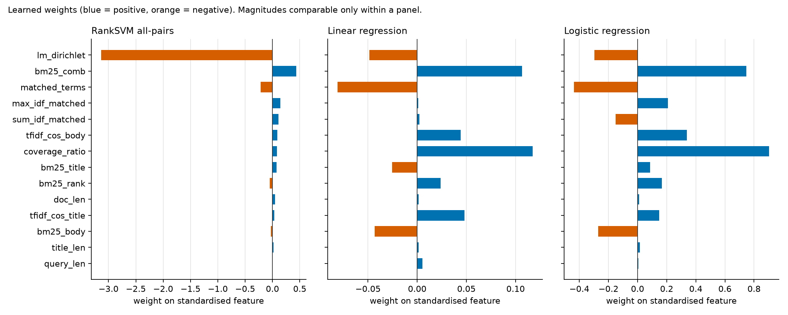
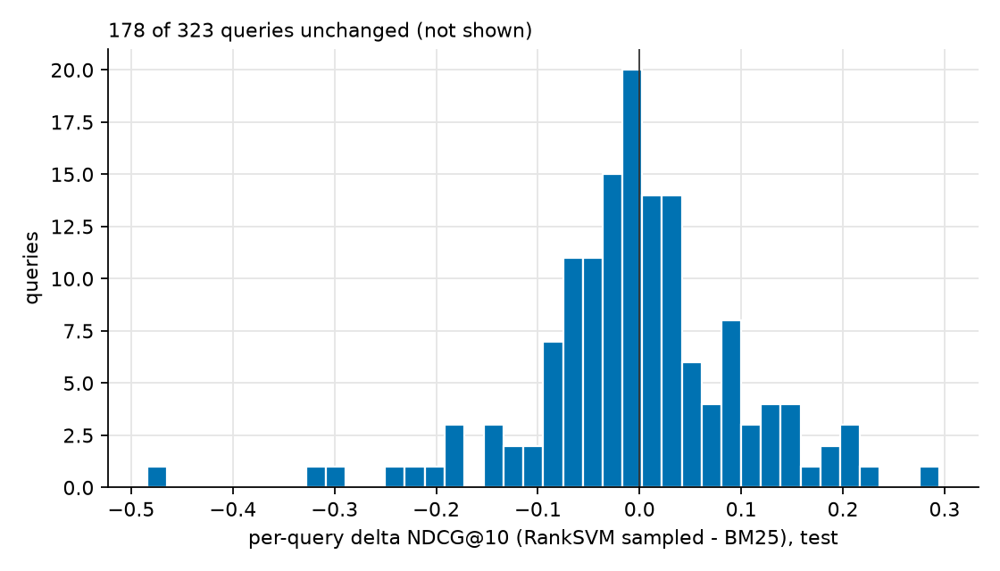
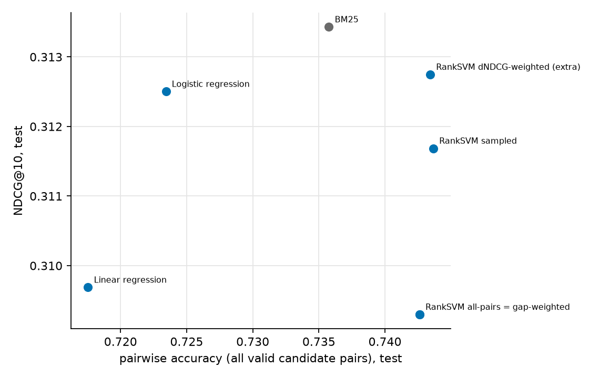

# Two-stage Learning-to-Rank on BEIR NFCorpus: BM25 Top-100 -> pointwise vs. Ranking-SVM re-ranking

*All numbers in this report are generated from files in `results/` by `src/make_report.py`; nothing is typed in by hand
except the per-query explanations in section 7b (which cite `results/query_evidence.md`). Re-running the pipeline regenerates the report,
and the generator aborts if a qualitative claim below stops being true.*

## 0. TL;DR (honest summary)

* On the held-out **test** queries no learned re-ranker beats the BM25 baseline: NDCG@10 BM25 = **0.3134**, the model selected on **dev** (RankSVM sampled) = 0.3117; the seven LTR models range from 0.3093 to 0.3127 (shown for completeness, never used for selection); MAP BM25 = 0.1408, dev-selected model MAP = 0.1425.
  All paired tests (t-test, Wilcoxon, also Holm-corrected) are non-significant (smallest raw p = 0.215); all bootstrap CIs contain 0.
* On the **dev** split the best LTR model (RankSVM sampled) looked slightly better than BM25 (NDCG@10 0.2817 vs 0.2744); this did not carry over to test - a reminder that tiny dev gains after selection are optimistic.
* Pairwise accuracy of every Ranking SVM is *higher* than BM25's (0.7426 vs 0.7358 for all-pairs) while its NDCG@10 is *lower*; the pointwise models have the lowest pairwise accuracy. Section 7c explains this with the data.
* The main reason for the limited headroom is **candidate generation**: only 15.3% (micro) of the relevant test documents are in BM25's Top-100 and 23.5% of test queries have *no* relevant document among their candidates. An oracle that re-ranks the same candidates with the true labels reaches only NDCG@10 = 0.5235, MAP = 0.2331.
* Grade-gap weighting is *degenerate* here: the BEIR NFCorpus **train** qrels contain only grade 1, so every training pair has gap 1 and the gap-weighted SVM is numerically identical to the all-pairs SVM. A rank-aware extra variant (dNDCG-weighted) is reported separately.

* **Extensions (section 9; decision rule = paired t AND Wilcoxon p<0.05 AND CI excluding 0):** (i) standard-hinge Ranking SVM: test NDCG@10 0.3086 (all pairs) / 0.3109 (sampled) vs squared hinge 0.3093 / 0.3117; 10 of 12 hinge fits hit the iteration limit. (ii) 5-fold query-level CV over 3,237 queries: 4 of 6 models improve and 0 of 6 degrade NDCG@10 vs BM25 (largest mean difference 0.0035, below the 0.01 practical threshold). (iii) Feature set v2: supported improvement over v1 for 4 of 4 models, over BM25 for 2 of 4, and over a stemmed-BM25-only rerank for 0 of 4 (a non-zero count there would mean a supported difference in either direction). (iv) Reduced v1 (all VIF < 10): weights are still NOT sign-interpretable.
* **Stemmed Stage 1 (section 10):** Recall@100 (micro, test) 0.1534 -> 0.1729, queries without a relevant candidate 0.235 -> 0.211; stemmed BM25 alone vs unstemmed BM25: NDCG@10 improvement supported, AP improvement supported. Learned models on the stemmed candidates beat unstemmed BM25 for 3 of 3 (NDCG@10), but differ from stemmed BM25 alone in a supported way for 0 of 3 (NDCG@10) and 1 of 3 (AP).

## 1. Setup and reproducibility

* Environment: `python 3.11.17 | numpy 2.4.6 | scipy 1.17.1 | sklearn 1.9.1 | pandas 3.0.6 | Windows-10-10.0.19045-SP0`, Windows 10, 13.9 GB RAM, no GPU. Libraries: numpy, pandas, scipy, scikit-learn, matplotlib (+ `ranx` only for the metric cross-check; `pytrec_eval` could not be built on this machine because it needs a C compiler).
* Seed: `42` everywhere (pair sampling, flips, bootstrap, solvers). Seeds per component are `SEED + k` (see `src/run_models.py`).
* Data: BEIR NFCorpus zip (`sha256 efe5be03f8c5b86a5870102d0599d227c8c6e2484328e68c6522560385671b0b`), downloaded from `https://public.ukp.informatik.tu-darmstadt.de/thakur/BEIR/datasets/nfcorpus.zip`.
* Full pipeline wall-clock (`bash run_all.sh`, including tests): **1631 s**. Per-step timings and every command/version/seed are logged in `results/run_log.txt`.
* BM25 parameters k1=1.2, b=0.75 (defaults, **not tuned**); LM-Dirichlet mu=1000 (fixed, not tuned); Top-K=100.

## 2. Dataset

BEIR NFCorpus: 3,633 documents (title + abstract; median 237 words), 3,237 queries (NutritionFacts article/video titles).
The official train/dev/test split exists and is **query-disjoint** (asserted in code and tests), so the official split is the main evaluation. (A query-level 5-fold cross-validation over all queries is added as a robustness check in section 9.2; it does not replace the official split.)

| split | #queries | #judgments | grade counts | mean judged docs / query |
|---|---|---|---|---|
| train | 2,590 | 110,575 | {'1': 110575} | 42.7 |
| dev | 324 | 11,385 | {'1': 10864, '2': 521} | 35.1 |
| test | 323 | 12,334 | {'1': 11758, '2': 576} | 38.2 |

Observations that matter for the experiment:

1. **Train qrels have only grade 1; dev/test have grades 1 and 2.** Graded labels are used where they exist (NDCG, pointwise regression target), but the training signal is effectively binary. (Source: `results/dataset_stats.json`.)
2. Only judged documents carry labels: **unjudged documents are treated as non-relevant** everywhere (training labels, MAP, NDCG, pairwise accuracy). In NFCorpus relevance comes from citation links, so topical but unlinked documents count as non-relevant; this penalises every system.
3. 40 groups of documents (80 docs) have identical title+text under different ids. They are left as they are (they are different corpus entries with their own judgments).
4. The corpus is shared across splits, as in the BEIR benchmark: 99.0% of dev-judged and 99.6% of test-judged documents are also judged for some train query. This is not label leakage, because no feature uses document identity or labels (verified by test `test_features_do_not_depend_on_labels_and_have_no_label_argument`), but length-like features could in principle let a model memorise documents that were often relevant. Corpus statistics (df, avgdl, collection frequencies) use all documents' text but never labels.
5. MAP uses binarised relevance (rel >= 1). NDCG uses graded labels.

## 3. Method

### 3.1 Stage 1 - BM25 Top-100
Own implementation (`src/bm25.py`): lower-casing, `[a-z0-9]+` tokens, scikit-learn English stop-word list, **no stemming**. For each field, `idf(t) = ln(1 + (N-df+0.5)/(df+0.5))`,
`score(q,d) = sum_(t in unique(q)) idf(t) * tf(k1+1)/(tf + k1(1-b+b*dl/avgdl))` (query-term multiplicity ignored). Retrieval field = title + text concatenated; only documents with score > 0 can be retrieved, so a query with fewer than 100 matching documents has fewer than 100 candidates (and a query with no match has none; such queries are kept in every metric with score 0 for every model).

### 3.2 Stage 2 - features (computed from raw text only; `src/features.py`)
`FEATURE_NAMES` = bm25_title, bm25_body, bm25_comb (field-specific BM25), tfidf_cos_title, tfidf_cos_body (sublinear tf x smoothed idf, cosine), lm_dirichlet (query likelihood with Dirichlet smoothing over title+text; unique query terms), query_len (tokens after stop-word removal), doc_len (body tokens), title_len, matched_terms (unique query terms present in title+text), coverage_ratio (matched / unique query terms), sum_idf_matched, max_idf_matched, bm25_rank (rank 1..n in the candidate list by bm25_comb).
No per-query normalisation was used. `StandardScaler` is fitted **on the training candidate rows only** (`results/scaler_stats.csv`); all weights below are on these standardised features.

### 3.3 Models (all re-rank the same candidate sets; ties are broken by BM25 rank)
1. BM25 baseline (score = bm25_comb).
2. Pointwise **linear regression** (OLS, target = graded label; in training all positives are 1).
3. Pointwise **logistic regression** (target rel >= 1; C tuned on dev from [0.001, 0.01, 0.1, 1, 10, 100]).
4-6. **Ranking SVM**: `LinearSVC(fit_intercept=False, dual=False, loss="squared_hinge")` on pair differences x_i - x_j; pairs only inside a query and only when labels differ; a random **exactly-half** of the pairs is flipped (x_j - x_i, -1) so classes are balanced. Squared hinge is scikit-learn's default and is not the classical hinge Ranking SVM; the primal solver is used because #pairs >> #features.
   * *all pairs*: every valid pair of every training query. **Memory control:** 977,151 valid pairs x 14 features; estimated training memory (float64 matrix + liblinear's internal copy) = 0.33 GB against a budget of 2.0 GB, so **all-pairs fits** and is used. (Measured peak process memory: 669 MB, section 5.)
   * *sampled pairs*: for each query, a uniform random sample **without replacement** of at most 200 valid pairs (queries with fewer keep all) -> 283,577 pairs (29.0% of all pairs). The cap is a design choice, not tuned.
   * *grade-gap-weighted*: all pairs, `sample_weight = |y_i - y_j|`.
   * *extra, not in the assignment*: **dNDCG-weighted** all pairs, `w = |2^y_i - 2^y_j| * |1/log2(1+rank_i) - 1/log2(1+rank_j)|` using BM25 ranks, normalised to mean 1. Added only because the gap weighting is degenerate on this training set.
* Hyper-parameter selection: **C in [0.001, 0.01, 0.1, 1, 10, 100] chosen on the dev split by NDCG@10** (first maximum, i.e. smallest C on ties). The test set is used once per model with the chosen C. Models are trained on train only (no refit on train+dev).

### 3.4 Evaluation definitions (`src/metrics.py`, written from scratch)
* NDCG@k with **gain 2^rel - 1** and discount 1/log2(rank+1) (primary; linear-gain NDCG@10 is also stored in the CSVs as `NDCG@10_lin`). **IDCG is computed from the full qrels** of the query, not from the candidates, so missing relevant documents (candidate recall) lower the score.
* AP = sum_k P@k * rel_k / (number of relevant documents in the full qrels), on the ranked candidate list (<= 100); MAP = mean over all queries of the split (including queries with no candidates, which count as 0).
* Pairwise accuracy = fraction of same-query pairs with different labels where the higher-labelled document has the higher score (ties count 0.5; tie fraction is in the CSV). *micro* pools all pairs; *macro* averages over queries having >= 1 valid pair.
* Unit tests (`tests/test_metrics.py`) check DCG/NDCG/AP/pairwise accuracy on hand-computed examples. **Cross-check against `ranx` on the real test run** (rankings passed as strictly decreasing scores so ties cannot differ):

| model | ndcg10_lin_ours | ndcg10_lin_ref | ndcg10_exp_ours | ndcg10_exp_ref | map_ours | map_ref | max_abs_diff |
|---|---|---|---|---|---|---|---|
| bm25 | 0.312596 | 0.312596 | 0.313430 | 0.313430 | 0.140764 | 0.140764 | 0.000000 |
| ranksvm_sampled | 0.311211 | 0.311211 | 0.311686 | 0.311686 | 0.142513 | 0.142513 | 0.000000 |
| logreg | 0.312245 | 0.312245 | 0.312502 | 0.312502 | 0.141878 | 0.141878 | 0.000000 |

### 3.5 Significance
Per-query differences vs BM25 on the 323 test queries; paired t-test, Wilcoxon signed-rank (zero differences dropped), 95% percentile bootstrap CI of the mean (10,000 query resamples), effect size Cohen's d_z = mean(delta)/sd(delta); Holm correction across the 6 models within each metric.

## 4. Candidate recall (Stage 1)

| split | n_queries | recall@100_macro | recall@100_micro | n_queries_zero_rel_in_cand | frac_queries_zero_rel_in_cand | frac_queries_lt100_cand | mean_rel_per_query | frac_queries_with_gt100_rel |
|---|---|---|---|---|---|---|---|---|
| dev | 324 | 0.2049 | 0.1572 | 89 | 0.2747 | 0.4599 | 35.1389 | 0.0586 |
| test | 323 | 0.2331 | 0.1534 | 76 | 0.2353 | 0.4613 | 38.1858 | 0.0681 |
| train | 2590 | 0.2323 | 0.1448 | 584 | 0.2255 | 0.4502 | 42.6931 | 0.0691 |

* Recall@100 is **low** (23.3% macro, 15.3% micro on test) partly because 6.8% of test queries have more than 100 relevant documents (so Recall@100 cannot reach 1) and partly because NFCorpus relevance is indirect (query = video title, relevant = papers cited on the page; vocabulary mismatch).
* **76 of 323 test queries (23.5%) have zero relevant documents among the candidates**; no re-ranker can change their NDCG/AP. 46.1% of test queries have fewer than 100 candidates because fewer than 100 documents contain any query term.
* Upper bound: re-ranking the same candidates with the true test labels would give MAP 0.2331 / NDCG@10 0.5235 (`results/oracle_upper_bound.csv`; uses test labels, for context only).

## 5. Results (test split, same candidate sets)

| model | MAP | NDCG@5 | NDCG@10 | pair acc (micro) | pair acc (macro) | C |
|---|---|---|---|---|---|---|
| BM25 | 0.1408 | 0.3433 | 0.3134 | 0.7358 | 0.7446 |  |
| Linear regression | 0.1408 | 0.3426 | 0.3097 | 0.7175 | 0.7395 |  |
| Logistic regression | 0.1419 | 0.3449 | 0.3125 | 0.7234 | 0.7432 | 0.01 |
| RankSVM all-pairs | 0.1418 | 0.3437 | 0.3093 | 0.7426 | 0.7518 | 10 |
| RankSVM sampled (dev-selected) | 0.1425 | 0.3465 | 0.3117 | 0.7437 | 0.7540 | 0.1 |
| RankSVM gap-weighted | 0.1418 | 0.3437 | 0.3093 | 0.7426 | 0.7518 | 10 |
| RankSVM dNDCG-weighted (extra) | 0.1421 | 0.3469 | 0.3127 | 0.7434 | 0.7542 | 0.01 |

All six assigned models and the extra dNDCG-weighted variant are listed. **Model selection is done on dev only**: the row marked *(dev-selected)* (RankSVM sampled, chosen by dev NDCG@10 among the LTR models) is the system that would be reported as 'the' LTR result; the other rows are shown for completeness and must not be read as a test-set selection.

Dev-split values (used for C selection; `results/metrics_dev.csv`):

| model | MAP | NDCG@5 | NDCG@10 | pair acc (micro) | pair acc (macro) | C |
|---|---|---|---|---|---|---|
| BM25 | 0.1028 | 0.2995 | 0.2744 | 0.7320 | 0.7396 |  |
| Linear regression | 0.1016 | 0.3055 | 0.2761 | 0.7356 | 0.7441 |  |
| Logistic regression | 0.1058 | 0.3072 | 0.2794 | 0.7410 | 0.7480 | 0.01 |
| RankSVM all-pairs | 0.1060 | 0.3064 | 0.2805 | 0.7469 | 0.7476 | 10 |
| RankSVM sampled | 0.1067 | 0.3077 | 0.2817 | 0.7472 | 0.7486 | 0.1 |
| RankSVM gap-weighted | 0.1060 | 0.3064 | 0.2805 | 0.7469 | 0.7476 | 10 |
| RankSVM dNDCG-weighted (extra) | 0.1052 | 0.3071 | 0.2812 | 0.7442 | 0.7460 | 0.01 |

Cost (train time of the final fit; predict time = median of 5 scorings of the 20,555 test candidate rows; memory = peak working set of the whole Python process sampled every 20 ms during `fit`, therefore it includes the already loaded data and is only an upper-level indicator, `results/metrics_test.csv`):

| model | train pairs | train time (s) | predict time, 32k rows (ms) | peak process RSS during fit (MB) |
|---|---|---|---|---|
| BM25 |  | 0.00 |  |  |
| Linear regression |  | 0.04 | 0.08 | 274.84 |
| Logistic regression |  | 0.20 | 0.06 | 279.34 |
| RankSVM all-pairs | 977,151 | 6.56 | 0.05 | 668.66 |
| RankSVM sampled | 283,577 | 1.98 | 0.05 | 387.45 |
| RankSVM gap-weighted | 977,151 | 6.28 | 0.07 | 685.39 |
| RankSVM dNDCG-weighted (extra) | 977,151 | 6.18 | 0.05 | 694.62 |

Full C grid on dev (`results/tuning_dev.csv`, figure `results/figures/tuning_curves_dev.png`): for the Ranking SVMs and logistic regression the metrics are practically flat for C >= 0.1 (differences in the 4th decimal), so the *selected* C within the plateau (e.g. 10 for all-pairs) is essentially arbitrary and should not be interpreted. No fit emitted a convergence warning (all fits converged).

Full tuning table

| model | C | MAP | NDCG@10 | dev pair acc | train_s | no_converge |
|---|---|---|---|---|---|---|
| linreg |  | 0.1016 | 0.2761 | 0.7356 | 0.0359 | False |
| logreg | 0.001 | 0.1045 | 0.2791 | 0.7414 | 0.1496 | False |
| logreg | 0.01 | 0.1058 | 0.2794 | 0.7410 | 0.1969 | False |
| logreg | 0.1 | 0.1050 | 0.2786 | 0.7402 | 0.2390 | False |
| logreg | 1 | 0.1049 | 0.2782 | 0.7399 | 0.2474 | False |
| logreg | 10 | 0.1050 | 0.2782 | 0.7399 | 0.2655 | False |
| logreg | 100 | 0.1050 | 0.2782 | 0.7399 | 0.2543 | False |
| ranksvm_all | 0.001 | 0.1049 | 0.2798 | 0.7453 | 6.0239 | False |
| ranksvm_all | 0.01 | 0.1059 | 0.2804 | 0.7467 | 5.9778 | False |
| ranksvm_all | 0.1 | 0.1059 | 0.2805 | 0.7469 | 7.1826 | False |
| ranksvm_all | 1 | 0.1059 | 0.2805 | 0.7469 | 6.3955 | False |
| ranksvm_all | 10 | 0.1060 | 0.2805 | 0.7469 | 6.5558 | False |
| ranksvm_all | 100 | 0.1060 | 0.2805 | 0.7469 | 6.4819 | False |
| ranksvm_sampled | 0.001 | 0.1047 | 0.2805 | 0.7441 | 1.2274 | False |
| ranksvm_sampled | 0.01 | 0.1060 | 0.2808 | 0.7470 | 2.0249 | False |
| ranksvm_sampled | 0.1 | 0.1067 | 0.2817 | 0.7472 | 1.9761 | False |
| ranksvm_sampled | 1 | 0.1064 | 0.2814 | 0.7473 | 2.2416 | False |
| ranksvm_sampled | 10 | 0.1064 | 0.2814 | 0.7473 | 2.1272 | False |
| ranksvm_sampled | 100 | 0.1064 | 0.2814 | 0.7472 | 2.3138 | False |
| ranksvm_gapweighted | 0.001 | 0.1049 | 0.2798 | 0.7453 | 5.8244 | False |
| ranksvm_gapweighted | 0.01 | 0.1059 | 0.2804 | 0.7467 | 5.6812 | False |
| ranksvm_gapweighted | 0.1 | 0.1059 | 0.2805 | 0.7469 | 7.0968 | False |
| ranksvm_gapweighted | 1 | 0.1059 | 0.2805 | 0.7469 | 6.3832 | False |
| ranksvm_gapweighted | 10 | 0.1060 | 0.2805 | 0.7469 | 6.2781 | False |
| ranksvm_gapweighted | 100 | 0.1060 | 0.2805 | 0.7469 | 6.2369 | False |
| ranksvm_dndcgweighted_extra | 0.001 | 0.1043 | 0.2800 | 0.7429 | 4.8033 | False |
| ranksvm_dndcgweighted_extra | 0.01 | 0.1052 | 0.2812 | 0.7442 | 6.1804 | False |
| ranksvm_dndcgweighted_extra | 0.1 | 0.1052 | 0.2811 | 0.7443 | 6.3157 | False |
| ranksvm_dndcgweighted_extra | 1 | 0.1052 | 0.2811 | 0.7443 | 6.4697 | False |
| ranksvm_dndcgweighted_extra | 10 | 0.1052 | 0.2811 | 0.7443 | 6.0023 | False |
| ranksvm_dndcgweighted_extra | 100 | 0.1052 | 0.2811 | 0.7443 | 6.4667 | False |

### 5.1 Significance vs BM25 (test, per-query paired differences)

| model | metric | mean_delta | ci95_lo | ci95_hi | p_ttest | p_ttest_holm | p_wilcoxon | p_wilcoxon_holm | cohen_dz | n_improved | n_harmed | n_unchanged |
|---|---|---|---|---|---|---|---|---|---|---|---|---|
| Linear regression | ndcg10 | -0.0037 | -0.0097 | 0.0021 | 0.2148 | 1.0000 | 0.3257 | 1.0000 | -0.0692 | 69 | 72 | 182 |
| Logistic regression | ndcg10 | -0.0009 | -0.0066 | 0.0043 | 0.7412 | 1.0000 | 0.7370 | 1.0000 | -0.0184 | 73 | 65 | 185 |
| RankSVM all-pairs | ndcg10 | -0.0041 | -0.0122 | 0.0036 | 0.3133 | 1.0000 | 0.4490 | 1.0000 | -0.0562 | 69 | 80 | 174 |
| RankSVM sampled | ndcg10 | -0.0017 | -0.0098 | 0.0057 | 0.6550 | 1.0000 | 0.6894 | 1.0000 | -0.0249 | 67 | 78 | 178 |
| RankSVM gap-weighted | ndcg10 | -0.0041 | -0.0122 | 0.0038 | 0.3133 | 1.0000 | 0.4490 | 1.0000 | -0.0562 | 69 | 80 | 174 |
| RankSVM dNDCG-weighted (extra) | ndcg10 | -0.0007 | -0.0073 | 0.0058 | 0.8411 | 1.0000 | 0.9297 | 1.0000 | -0.0112 | 69 | 69 | 185 |
| Linear regression | ap | 0.0001 | -0.0024 | 0.0025 | 0.9649 | 1.0000 | 0.7304 | 1.0000 | 0.0025 | 91 | 98 | 134 |
| Logistic regression | ap | 0.0011 | -0.0009 | 0.0032 | 0.2879 | 1.0000 | 0.4551 | 1.0000 | 0.0592 | 96 | 92 | 135 |
| RankSVM all-pairs | ap | 0.0011 | -0.0019 | 0.0041 | 0.4878 | 1.0000 | 0.4299 | 1.0000 | 0.0386 | 96 | 91 | 136 |
| RankSVM sampled | ap | 0.0017 | -0.0012 | 0.0047 | 0.2533 | 1.0000 | 0.2754 | 1.0000 | 0.0637 | 97 | 89 | 137 |
| RankSVM gap-weighted | ap | 0.0011 | -0.0020 | 0.0039 | 0.4878 | 1.0000 | 0.4299 | 1.0000 | 0.0386 | 96 | 91 | 136 |
| RankSVM dNDCG-weighted (extra) | ap | 0.0013 | -0.0012 | 0.0037 | 0.3026 | 1.0000 | 0.2429 | 1.0000 | 0.0575 | 96 | 90 | 137 |

*Statistical vs practical significance.* No difference is statistically significant (raw or Holm-adjusted), and every 95% CI includes 0. The largest mean change in NDCG@10 is 0.0041 (absolute), well below the 0.01 that we (arbitrarily, by convention) regard as the smallest change a user could care about, and Cohen's d_z is at most 0.069 (negligible). Note that 178 of 323 queries are unchanged for the best model, mostly the 76 with no relevant candidate, so the paired tests have an effective sample of 145 queries (this is what the Wilcoxon test uses). With ~323 queries the study could only detect effects of roughly |mean delta| >= 0.011 (about the standard error x 2.8 for 80% power), so "no significant difference" is **not** evidence that the models are equal; it says the difference, if any, is small.

## 6. Pitfall checklist

| pitfall | how it is avoided / test |
|---|---|
| pairs across different queries | `pairs.build_pairs` forms pairs inside query groups only and asserts `qid[i]==qid[j]`; test `test_pairs_same_query_different_label_balanced`. Ablation B (section 7e) shows what cross-query pairs do. |
| equal-label pairs used as preferences | only `y_i > y_j` pairs are generated; assertion `y[I] > y[J]` and the same test. |
| unbalanced pair directions | exactly half of the pairs flipped (assert `|frac(+1)-0.5|<=1/n` in `run_models.py`; test checks <= 1 difference). A single-class pair set cannot even be fitted (ablation table). |
| C selected on test | C chosen on dev only (`run_models.py`, `tuning_dev.csv`); the test split is scored after the choice; the "best LTR model" for the per-query analysis is also chosen on dev. |
| ignoring candidate-generation recall | section 4 (`candidate_recall*.csv`); IDCG/AP use full qrels; oracle upper bound reported. |
| random row-level split | official **query-level** split; `assert_query_disjoint` + assertion in `run_models.py`; test `test_no_query_in_two_splits_detects_leak`. |
| scaler fitted on test | `StandardScaler.fit` on train rows only; assertion `scaler.mean_ == train mean`; tests `test_scaler_statistics_come_from_train_only` and `test_saved_scaler_matches_train_split_if_results_exist` (checks the saved `scaler_stats.csv` against the train rows). |
| row-level / non-query folds in CV | folds are a function of the query id (`run_cv.assign_folds`); the per-query scoring asserts that each query is scored out-of-fold exactly once; tests `test_folds_are_query_level_complete_and_balanced`, `test_row_level_split_would_be_detected_but_query_folds_never_share_queries`. |
| tuning on the CV test fold / scaler leakage in CV | C is chosen on an inner validation split of the *training-fold queries* (`inner_split`, test `test_inner_validation_split_is_query_level_disjoint_and_sized`); the scaler is fitted on training-fold rows only (`test_scaler_helper_uses_training_frame_only`). |
| label-derived features in v2 | `compute_v2_new` has no label argument (test `test_no_label_argument`); labels are never read by `features_v2.py`. |
| all pairs without memory control | `count_pairs` and `estimate_memory_gb` before building; budget 2.0 GB; decision logged in `pair_stats.json`; capped sampled variant provided and compared. |
| evaluating only classification accuracy | MAP, NDCG@5/10 are reported next to pairwise accuracy; section 7c shows they can disagree. |
| duplicate docs across splits | corpus is shared by design (BEIR); duplicates are documented (section 2); features use no doc identity or labels (test `..._do_not_depend_on_labels...`). Query ids are disjoint across splits. |
| features leaking labels | `stage1_and_features` has no label argument (test inspects the signature); labels are attached after feature computation. |
| metric bugs | hand-computed unit tests + cross-check with ranx on the real run (section 3.4). |

## 7. Analysis

### 7a. Feature weights (standardised features; `results/weights_table.csv`, figure `results/figures/feature_weights.png`)

Weights are comparable *across features within one model* only because all features were standardised on the training set (unit variance). Magnitudes are **not** comparable *between* models (OLS predicts a 0/1 label, logistic regression works on log-odds, the SVM on margin units). Univariate columns: Spearman correlation of the feature with the label on the training candidates (pooled and after centring inside each query); VIF = collinearity diagnostic from the training correlation matrix; `expected_sign` was fixed *before* looking at weights (+1 = more is better, 0 = no expectation).

| feature | ranksvm_all | ranksvm_sampled | linreg | logreg | expected_sign | spearman_with_label_train | spearman_within_query_train | VIF | sign_ok_ranksvm_all | sign_ok_linreg | sign_ok_logreg |
|---|---|---|---|---|---|---|---|---|---|---|---|
| lm_dirichlet | -3.135 | -2.627 | -0.049 | -0.297 | 1 | 0.187 | 0.171 | 9.776 | NO | NO | NO |
| bm25_comb | 0.438 | 0.396 | 0.106 | 0.746 | 1 | 0.197 | 0.210 | 39.008 | yes | yes | yes |
| matched_terms | -0.213 | -0.203 | -0.081 | -0.438 | 1 | 0.065 | 0.132 | 9.464 | NO | NO | NO |
| max_idf_matched | 0.142 | 0.147 | 0.001 | 0.207 | 1 | 0.155 | 0.105 | 7.286 | yes | yes | yes |
| sum_idf_matched | 0.109 | 0.070 | 0.002 | -0.150 | 1 | 0.155 | 0.148 | 21.102 | yes | yes | NO |
| tfidf_cos_body | 0.089 | 0.068 | 0.044 | 0.339 | 1 | 0.285 | 0.192 | 8.340 | yes | yes | yes |
| coverage_ratio | 0.083 | 0.139 | 0.117 | 0.904 | 1 | 0.239 | 0.140 | 4.730 | yes | yes | yes |
| bm25_title | 0.073 | 0.063 | -0.026 | 0.086 | 1 | 0.144 | 0.121 | 11.657 | yes | NO | yes |
| bm25_rank | -0.049 | -0.043 | 0.024 | 0.166 | -1 | -0.210 | -0.122 | 1.875 | yes | NO | NO |
| doc_len | 0.047 | 0.042 | 0.001 | 0.012 | 0 | 0.009 | 0.004 | 1.190 |  |  |  |
| tfidf_cos_title | 0.033 | 0.040 | 0.048 | 0.147 | 1 | 0.165 | 0.137 | 10.066 | yes | yes | yes |
| bm25_body | -0.029 | -0.007 | -0.043 | -0.269 | 1 | 0.183 | 0.188 | 24.591 | NO | NO | NO |
| title_len | 0.018 | 0.011 | 0.001 | 0.016 | 0 | 0.010 | 0.011 | 1.126 |  |  |  |
| query_len | 0.000 | 0.000 | 0.005 | 0.005 | 0 | -0.158 |  | 11.961 |  |  |  |

* Largest |weights| in the all-pairs SVM: lm_dirichlet (-3.14), bm25_comb (+0.44), matched_terms (-0.21), max_idf_matched (+0.14); top positive: bm25_comb (+0.438), top negative: lm_dirichlet (-3.135).
* **Sign sanity check: it fails for lm_dirichlet and matched_terms** (negative weights in the SVM, linear and logistic models although each correlates *positively* with relevance, Spearman 0.187 and 0.065); bm25_body is also negative in all three. The reason is collinearity, not an IR principle: VIFs are 39.008 (bm25_comb), 24.591 (bm25_body), 21.102 (sum_idf_matched), 9.776 (lm_dirichlet), so individual coefficients are not interpretable; the model uses them as corrections relative to bm25_comb (e.g. "BM25 score per number of matched terms"). Only the *combined* score is meaningful. Per-feature importance should therefore not be read from single weights.
* **query_len has weight exactly 0.0 in every Ranking SVM**: it is constant inside a query, so it cancels in every pair difference x_i - x_j. In the pointwise models it receives a small nonzero weight (+0.005, +0.005) which cannot change a within-query ranking either (a constant added to all candidates). Likewise bm25_rank is a deterministic monotone function of bm25_comb inside a query, so the two are redundant for ranking except for scale/non-linearity.
* The two pointwise models and the Ranking SVM agree on the sign for 10 of 14 features. Sign agreement for `bm25_rank`, `bm25_title` (OLS vs SVM) is lacking; weights of near-collinear features are unstable.
* Weights come from one training run per model (no bootstrap of the weights), so no uncertainty is attached to them.

### 7b. Queries improved / harmed by LTR

Best LTR model **chosen on dev** by NDCG@10: **RankSVM sampled** (C = 0.1). Per-query delta = NDCG@10(LTR) - NDCG@10(BM25) on test (`results/query_deltas_best_model.csv`, figure `results/figures/delta_ndcg10_hist.png`). 145 queries changed, 178 did not (of which 76 have no relevant document in the candidates). Raw evidence for every query below (entering/leaving documents with labels and ranks, all relevant candidates, feature-contribution differences w*z) is in `results/query_evidence.md` and `results/query_evidence.csv`.

**Top 10 improved**

| qid | query | NDCG@10 BM25 -> LTR (delta) | #rel total / in candidates / recall@100 | evidence-based explanation |
|---|---|---|---|---|
| PLAIN-371 | Any update on the scary in vitro avocado data? | 0.119 -> 0.413 (+0.295) | 2 / 2 / 1.000 | Only 2 relevant documents. The rel=2 document moves BM25#11 -> LTR#7 and a rel=1 document #4 -> #3; the document it replaces, "An update on bioactive plant lignans", matches only the generic query word *update*. The gain rests on one document, so it is fragile. |
| PLAIN-430 | Are krill oil supplements better than fish oil capsules? | 0.615 -> 0.837 (+0.223) | 8 / 5 / 0.625 | Two rel=2 documents (BM25#15 and #23) enter the top-10 at LTR#5 and #9, pushing out three non-relevant diet/pollutant papers. The entering documents have a *lower* bm25_comb and fewer matched terms than the ones they replace, so this is not a 'better lexical match' effect; it looks incidental to the learned weight combination. |
| PLAIN-1537 | low-carb diets | 0.000 -> 0.205 (+0.205) | 45 / 8 / 0.178 | BM25's top-10 contained no relevant document (NDCG 0). Two relevant papers whose titles contain "Low-Carbohydrate Diets" (BM25#11, #21) rise to LTR#3 and #4, displacing off-topic *diet* papers (protein, flaxseed, fat). Driver: bm25_title. Three of the five entering documents are non-relevant, so the gain is two documents. |
| PLAIN-207 | Avoiding Cooked Meat Carcinogens | 0.255 -> 0.460 (+0.205) | 55 / 15 / 0.273 | A relevant document enters at LTR#9 (BM25#13) and relevant documents already in the top-10 move up (BM25#3->#1, #9->#4). One entering non-relevant document is on-topic (heterocyclic amines) and may simply be unjudged. Feature differences are small (largest 0.34). |
| PLAIN-1453 | junk food | 0.305 -> 0.509 (+0.204) | 245 / 25 / 0.102 | 4 of the 5 entering documents are relevant (food additives, children's food intake) while the 5 leaving ones are food-safety/handling papers that match *food* but not *junk*. Only 25 of 245 relevant documents are in the candidates, so a few promotions matter a lot. No single feature explains it (all contribution differences <= 0.07). |
| PLAIN-280 | Mercury Testing Recommended Before Pregnancy | 0.322 -> 0.514 (+0.191) | 20 / 8 / 0.400 | No new relevant document enters; relevant documents already in the top-10 move up (BM25#2->#1, #3->#2, #7->#5, #12->#8). The gain is a pure re-ordering; largest contribution differences are bm25_comb (negative) and matched_terms. |
| PLAIN-2991 | Cholesterol and Lower Back Pain | 0.204 -> 0.387 (+0.182) | 2 / 1 / 0.500 | The only relevant document in the top-10 (rel=2) moves from BM25#7 to LTR#2, while all five entering documents are non-relevant. The entering/leaving comparison does not explain why this particular document moved (its own feature vector was not inspected), so no causal explanation is claimed. |
| PLAIN-2730 | Anti-Angiogenesis: Cutting Off Tumor Supply Lines | 0.294 -> 0.463 (+0.169) | 29 / 10 / 0.345 | Two rel=2 documents with *angiogenesis* in the title enter at LTR#4 and #5 (from BM25#14, #20); two off-topic Campylobacter papers also enter, and other relevant documents shuffle (BM25#4->#8, #6->#10, #7->#3). Net positive but mixed. Entering documents have lower bm25_comb and fewer matched terms. |
| PLAIN-3332 | Alcohol Risks vs. Benefits | 0.330 -> 0.488 (+0.158) | 14 / 9 / 0.643 | A rel=1 document enters (BM25#11 -> #9) and a rel=2 document moves #5 -> #2; two entering documents are non-relevant. A small effect from one or two documents. |
| PLAIN-3141 | Relieving Yourself of Excess Estrogen | 0.000 -> 0.147 (+0.147) | 34 / 5 / 0.147 | BM25's top-10 had no relevant document (NDCG 0). One rel=2 document (title about estrogen excretion) moves BM25#11 -> #4; the four other entering documents are non-relevant. The entire gain is this single document (driver: bm25_title). |

**Top 10 harmed**

| qid | query | NDCG@10 BM25 -> LTR (delta) | #rel total / in candidates / recall@100 | evidence-based explanation |
|---|---|---|---|---|
| PLAIN-3085 | The Difficulty of Arriving at a Vitamin D Recommendation | 0.484 -> 0.000 (-0.484) | 2 / 2 / 1.000 | Both rel=2 documents (BM25#3 and #10) fall to #22 and #12; four non-relevant vitamin-D papers (e.g. "Vitamin D: extraskeletal health") take their place. These are topical, so part of the harm may be a judgement artefact (unjudged = non-relevant). Driver: lm_dirichlet, whose learned weight is negative - the entering documents have a *lower* LM score. |
| PLAIN-3026 | Vitamin C-Enriched Bacon | 0.315 -> 0.000 (-0.315) | 1 / 1 / 1.000 | A single relevant document (rel=2) falls from BM25#8 to #14; the two entering documents are non-relevant and longer (doc_len contribution +0.11). With one relevant document NDCG@10 goes 0.315 -> 0 on a one-position-pair swap. |
| PLAIN-2460 | Diabetes as a Disease of Fat Toxicity | 0.399 -> 0.102 (-0.296) | 31 / 8 / 0.258 | The rel=2 "Banting Memorial Lecture" falls BM25#1 -> #6 and another rel=2 document #5 -> #12; six non-relevant diabetes-diet papers enter. Driver: matched_terms, whose weight is negative (entering documents match *fewer* query terms). |
| PLAIN-2500 | The Saturated Fat Studies: Buttering Up the Public | 0.299 -> 0.062 (-0.237) | 7 / 3 / 0.429 | Two rel=2 documents drop (BM25#5 -> #30, #9 -> #18) while one rel=1 document rises to #4; five non-relevant saturated-fat papers enter. Driver: matched_terms (negative weight) again. |
| PLAIN-2700 | Heart Disease Starts in Childhood | 0.215 -> 0.000 (-0.215) | 10 / 3 / 0.300 | The rel=2 "Pathobiological determinants of atherosclerosis in youth" falls BM25#2 -> #18; entering documents are about *childhood* soy/dairy/leukemia, i.e. they match one query word. Driver: matched_terms (entering documents match fewer terms). |
| PLAIN-2354 | walnut oil | 0.553 -> 0.345 (-0.208) | 5 / 2 / 0.400 | Very short query, two relevant documents; a rel=1 document moves BM25#1 -> #5 while one non-relevant document enters. Drivers: bm25_title, tfidf_cos_title. A small re-ordering that costs a lot only because NDCG@10 of this query is already based on 2 documents. |
| PLAIN-3171 | Convergence of Evidence | 0.191 -> 0.000 (-0.191) | 34 / 8 / 0.235 | Generic query ("Convergence of Evidence"). The LTR model promotes documents with *evidence* in the title (bm25_title, tfidf_cos_title) and pushes three relevant documents from BM25#2, #8, #9 to #39, #29, #28. Lexical signal is weak (recall@100 0.235), and the title-field features overweight the generic word. |
| PLAIN-2680 | Counteracting the Effects of Dioxins Through Diet | 0.189 -> 0.000 (-0.189) | 14 / 4 / 0.286 | Two rel=2 documents (BM25#5, #8: flavonols / AhR ligands, i.e. *indirect* relevance) fall to #13, #14; three literal dioxin-exposure papers, judged non-relevant, enter. Relevance in NFCorpus is based on citation links, so literal topical matches are not necessarily relevant. |
| PLAIN-2540 | Does Cholesterol Size Matter? | 0.253 -> 0.073 (-0.180) | 21 / 9 / 0.429 | Generic words of the title query (*does ... matter*) pull in "Human gut microbiota: does diet matter?" at LTR#4; the rel=2 document at BM25#1 falls to #8. Contribution differences are small (largest 0.16). |
| PLAIN-102 | Stopping Heart Disease in Childhood | 0.149 -> 0.000 (-0.149) | 24 / 1 / 0.042 | Only 1 of 24 relevant documents is in the candidates (recall@100 0.042); it falls BM25#5 -> #22 and three documents containing *childhood* enter. Nothing was available to rerank well; the harm is one document. |

What the evidence shows (computed from `query_evidence.csv`):

* Improvements are mostly **a few relevant documents moving from BM25 ranks ~11-50 into the top-10**: in the improved list 15 relevant documents enter the top-10 and 1 leave it; in the harmed list 1 relevant documents enter and 14 leave. Harmed queries mainly lose **one or two relevant documents that BM25 already had in its top-10** (many such queries have only 1-3 relevant documents, so the NDCG swing is large).
* In the harmed queries the largest contribution differences are mostly from matched_terms (6 of 10 have it in their top-3 contribution differences; 7 of 10 improved ones do as well) and lm_dirichlet - exactly the features that failed the sign check - i.e. the learned combination prefers documents with *fewer* matched terms / lower LM score at similar BM25, which is sometimes right and sometimes wrong. We therefore see no systematic "better matching" mechanism; both lists are dominated by single-document moves.
* Harm is often compounded by **unjudged-as-non-relevant**: the documents that replace the lost relevant ones often look on-topic judging by their titles (e.g. PLAIN-3085, PLAIN-2680); we did not read their full text.
* Groups by candidate recall (`query_groups_by_recall.csv`):

| recall_bucket | n_queries | mean_ndcg10_bm25 | mean_delta_ndcg10 | n_improved | n_harmed |
|---|---|---|---|---|---|
| 0 | 76 | 0.0000 | 0.0000 | 0 | 0 |
| (0,0.1] | 53 | 0.2574 | 0.0006 | 13 | 12 |
| (0.1,0.3] | 107 | 0.3574 | -0.0014 | 34 | 41 |
| >0.3 | 87 | 0.5672 | -0.0051 | 20 | 25 |

  Mean delta stays close to 0 in every group; queries with high BM25 NDCG@10 tend to lose slightly (Spearman between delta and BM25 NDCG@10 = -0.101, weak, consistent with regression to the mean plus noise).
* Top-10 lists are selected by extreme deltas out of 323 queries, so they are partly noise; they illustrate mechanisms and should not be read as per-query "rules".

### 7c. Why pairwise accuracy and NDCG can disagree (our results)

| model | NDCG@10 | pair_acc_all_pairs | pair_acc_pairs_with_a_BM25_top10_doc | pair_acc_pairs_entirely_below_BM25_top10 |
|---|---|---|---|---|
| BM25 | 0.3134 | 0.7358 | 0.8468 | 0.6640 |
| Linear regression | 0.3097 | 0.7175 | 0.8443 | 0.6356 |
| Logistic regression | 0.3125 | 0.7234 | 0.8442 | 0.6454 |
| RankSVM all-pairs | 0.3093 | 0.7426 | 0.8473 | 0.6750 |
| RankSVM sampled | 0.3117 | 0.7437 | 0.8483 | 0.6761 |
| RankSVM gap-weighted | 0.3093 | 0.7426 | 0.8473 | 0.6750 |
| RankSVM dNDCG-weighted (extra) | 0.3127 | 0.7434 | 0.8480 | 0.6759 |

* Ranking SVMs have the **highest** pairwise accuracy (all-pairs 0.7426, BM25 0.7358) yet all-pairs NDCG@10 is **lower** (0.3093 vs 0.3134). Pairwise accuracy counts every valid pair in the 100-document list equally, whereas NDCG@10 only looks at the top 10 positions with a log discount. Only 39.3% of valid pairs involve a document in BM25's top-10; the SVM's pairwise gain over BM25 is concentrated in the other pairs (below-top-10 pairs: 0.6750 vs 0.6640; pairs with a top-10 document: 0.8473 vs 0.8468), which NDCG@10 ignores.
* Micro pairwise accuracy is dominated by queries with many relevant documents (many pairs); NDCG@10 averages queries equally. Per query, the change in pairwise accuracy and the change in NDCG@10 are positively but only moderately related (Spearman 0.450); NDCG falls while pairwise accuracy rises in 26 queries and the opposite happens in 13.
* Pointwise models have the *lowest* pairwise accuracy (linear 0.7175, logistic 0.7234) because their loss does not compare documents of the same query; a global regression on raw scores partly learns query difficulty rather than within-query order. Their NDCG@10 is nevertheless close to BM25's, so a *low* pairwise accuracy does not imply a bad top-10.
* Hence pairwise accuracy alone is not a sufficient evaluation; the figure `results/figures/pairacc_vs_ndcg10.png` shows the (non-monotone) relation. The NDCG@10 axis spans only 0.3093-0.3134, i.e. differences are tiny.

### 7d. Pointwise vs. pairwise; all-pairs vs. sampled vs. weighted

* **Pointwise vs pairwise.** Test NDCG@10: linear 0.3097, logistic 0.3125, SVM all-pairs 0.3093, SVM sampled 0.3117; MAP: 0.1408, 0.1419, 0.1418, 0.1425. The differences between these models are far smaller than the paired-test noise (section 5.1), so **no ranking of pointwise vs pairwise by NDCG/MAP is supported**. What *is* supported: the pairwise models have clearly higher pairwise accuracy than the pointwise ones (and than BM25), as expected from the objective they optimise. Pointwise models are 1-2 orders of magnitude cheaper to train (0.04 s and 0.20 s vs 6.6 s for all-pairs).
* **All-pairs vs sampled.** Sampling to <= 200 pairs per query keeps 29.0% of the pairs, trains 3.3x faster and uses less memory (387 MB vs 669 MB process peak), with no loss in MAP/NDCG (test NDCG@10 0.3117 vs 0.3093; dev 0.2817 vs 0.2805) and slightly higher pairwise accuracy. Sampling also reduces the dominance of queries with many pairs (pairs per query grow ~ quadratically with the number of relevant candidates), which is a plausible reason; we did not test that hypothesis separately. These differences are within noise.
* **Weighted.** Gap-weighting is **identical** to all-pairs (all MAP/NDCG/pairwise values equal; the training pairs all have gap 1 because train qrels only contain grade 1), so this experiment cannot tell whether gap-weighting helps on graded data. The rank-aware extra variant gives NDCG@10 0.3127 / MAP 0.1421 (test), again within noise of the others; its dev NDCG@10 was 0.2812.

### 7e. Course discussion questions that the results support

*Why must pairs come from the same query?* Relevance and feature scales are query-relative (e.g. a BM25 score of 12 can be excellent for one query and poor for another), so a cross-query pair asks the model to compare scores that are not comparable and its "preference" says nothing about ranking. Ablation (C fixed to the dev-chosen value for the sampled SVM, **no tuning**, same number of pairs; `results/ablation.csv`; the reference row differs a little from the main sampled SVM only because of a different sampling seed):

| variant | C | n_pairs | intercept | dev_NDCG@10 | dev_pair_acc | test_NDCG@10 | test_MAP | test_pair_acc |
|---|---|---|---|---|---|---|---|---|
| A within-query pairs, no intercept (reference) | 0.1000 | 283577 | 0.0000 | 0.2819 | 0.7474 | 0.3109 | 0.1425 | 0.7433 |
| B cross-query pairs, no intercept (pitfall) | 0.1000 | 283577 | 0.0000 | 0.2791 | 0.7428 | 0.3135 | 0.1417 | 0.7233 |
| C within-query pairs, WITH intercept | 0.1000 | 283577 | 0.0016 | 0.2819 | 0.7474 | 0.3111 | 0.1425 | 0.7433 |

Training on cross-query pairs lowers test pairwise accuracy (0.7233 vs 0.7433); its NDCG@10 is 0.3135 vs 0.3109 on test and 0.2791 vs 0.2819 on dev, i.e. not distinguishable at this noise level and in the opposite directions on the two splits. So our data support the claim for the *pairwise* objective, not for NDCG@10; the conceptual argument above is the main reason.

*Why no intercept?* A ranking score only matters through differences between documents of one query; an intercept adds the same constant to every document and cancels in x_i - x_j. With balanced directions the fitted intercept is 0.0016 and the metrics are unchanged (variant C vs A: test NDCG@10 0.3111 vs 0.3109).

*Why balance the pair directions?* If all pairs were stored as (better - worse, +1) the data contain a single class and the SVM cannot be fitted at all (`fails: This solver needs samples of at least 2 classes in the data, but the data contains only on`); with an intercept it could learn a trivial solution (we did not test this). Random flipping gives a symmetric problem in which the weight vector alone must separate the pairs.

*How to sample pairs for large data?* Count valid pairs first (`count_pairs`) and estimate memory; if over budget, sample uniformly without replacement within each query with a per-query cap (our rule: <= 200 pairs/query), which bounds memory at ~ n_queries x cap x features and balances query contributions. Alternatives (not run here): sample documents instead of pairs, or sample pairs with probability proportional to grade gap or rank-based weights (our extra variant weights, not samples, by rank).

## 8. Limitations and uncertainties

* One dataset and one official train/dev/test split (section 9.2 repeats the evaluation on 5 query-level folds of the same data); one seed, no repeated runs, so no estimate of seed variance. All LTR-vs-BM25 differences are within noise; conclusions about *relative* model quality are not supported.
* Features are mostly lexical variants of BM25, nearly collinear, and the baseline already uses the best of them; there is little new signal for a linear model. No non-linear model, no stemming, no semantic features, no per-query normalisation.
* Candidate recall is the dominant bottleneck (23.5% of test queries have no relevant candidate). BM25 parameters and LM mu were not tuned.
* Train qrels only have grade 1 while dev/test have grades 1-2: the graded-label aspects (linear regression on graded targets, gap weighting) are barely exercised.
* Unjudged documents are treated as non-relevant, penalising on-topic but unlinked documents.
* Squared-hinge LinearSVC is used (not hinge); pairwise ties count 0.5; Wilcoxon drops zero differences.
* C plateau: for C >= 0.1 SVM results hardly change, so the chosen C is arbitrary within the plateau.
* Peak memory is the whole-process working set (Windows API sampling), not isolated to the model; timings are single measurements on one desktop machine.
* The per-query explanations (section 7b) were written by the author after reading `query_evidence.md`; they are interpretations of that evidence (the evidence itself is generated), and several are explicitly inconclusive.
* Cross-check of the metrics used `ranx`; `pytrec_eval` could not be installed (no C compiler).

## 9. Extensions (added after review)

Everything in sections 0-8 is unchanged (the original pipeline and its files are untouched). The extensions below are separate scripts that write `results/ext_*.csv`.
**Decision rule for any claim in this section:** a difference counts as an improvement (or degradation) only if the paired t-test *and* the Wilcoxon test both give raw p < 0.05 *and* the 95 % bootstrap CI of the mean per-query difference excludes 0. Holm-adjusted p-values are always shown; where they disagree with the raw rule this is said explicitly. Nothing in this section was tuned on test data: C is always chosen on a validation split (dev, or the inner validation split in the cross-validation).

### 9.1 Standard-hinge vs squared-hinge Ranking SVM (feature set v1, official split)

Which loss matches the course slides? The Ranking SVM objective in `Chap_8.pdf` (slides 91-92) is 1/2||w||^2 + C * sum max(0, 1 - w^T(x_i - x_j)), i.e. the **standard (L1) hinge**; the code snippet on slide 109 is `LinearSVC(C=1.0, fit_intercept=False)`, which in scikit-learn is the **squared** hinge (default `loss="squared_hinge"`). The main experiments used squared hinge (primal solver); here the standard hinge is added with `LinearSVC(loss="hinge", dual=True, fit_intercept=False)` (the only combination scikit-learn offers for hinge), same pair sets, same seeds, same C grid tuned on dev. Files: `ext_hinge_metrics_test.csv`, `ext_hinge_tuning_dev.csv`, `ext_hinge_significance.csv`.

| model | loss | C (dev) | dev NDCG@10 | test MAP | test NDCG@5 | test NDCG@10 | test pair acc | train s | converged |
|---|---|---|---|---|---|---|---|---|---|
| RankSVM all-pairs | squared hinge (sklearn default) | 10 | 0.2805 | 0.1418 | 0.3437 | 0.3093 | 0.7426 | 6.5558 | yes |
| RankSVM all-pairs, standard hinge | standard hinge | 1 | 0.2808 | 0.1413 | 0.3401 | 0.3086 | 0.7444 | 49.2611 | NO (max_iter reached) |
| RankSVM sampled | squared hinge (sklearn default) | 0.1 | 0.2817 | 0.1425 | 0.3465 | 0.3117 | 0.7437 | 1.9761 | yes |
| RankSVM sampled, standard hinge | standard hinge | 0.1 | 0.2814 | 0.1421 | 0.3460 | 0.3109 | 0.7448 | 1.4091 | NO (max_iter reached) |

* **Convergence:** 10 of 12 hinge fits reached `max_iter=1000` without meeting the tolerance (liblinear dual coordinate descent; all squared-hinge fits converged: 0 warnings in `tuning_dev.csv`). Hinge solutions are therefore approximate; the chosen models are not converged (all-pairs) / not converged (sampled).
* **C = 100 is unusable for the hinge variants** (dev NDCG@10 0.1991 all-pairs and 0.1592 sampled, versus a best of 0.2808 and 0.2814); the dual solver stops far from the optimum there. Selecting C on dev avoids this.
* Training time of the chosen fits: hinge all-pairs 49.3 s vs squared-hinge 6.6 s; the whole hinge C grid took far longer than the squared-hinge grid (see `ext_hinge_tuning_dev.csv`, column `train_s`).

Paired tests (test queries, per-query NDCG@10 and AP):

| comparison | model | mean_delta | ci95_lo | ci95_hi | p_ttest | p_wilcoxon | p_ttest_holm | cohen_dz | verdict |
|---|---|---|---|---|---|---|---|---|---|
| vs BM25 | ranksvm_hinge_all | -0.0049 | -0.0124 | 0.0027 | 0.2065 | 0.2608 | 0.4130 | -0.0704 | no supported difference |
| vs BM25 | ranksvm_hinge_sampled | -0.0025 | -0.0099 | 0.0048 | 0.5009 | 0.5983 | 0.5009 | -0.0375 | no supported difference |
| vs ranksvm_all (squared hinge) | ranksvm_hinge_all | -0.0007 | -0.0026 | 0.0013 | 0.4561 | 0.1352 | 0.4561 | -0.0415 | no supported difference |
| vs ranksvm_sampled (squared hinge) | ranksvm_hinge_sampled | -0.0007 | -0.0031 | 0.0017 | 0.5434 | 0.1003 | 0.5434 | -0.0338 | no supported difference |

| comparison | model | mean_delta | ci95_lo | ci95_hi | p_ttest | p_wilcoxon | p_ttest_holm | cohen_dz | verdict |
|---|---|---|---|---|---|---|---|---|---|
| vs BM25 | ranksvm_hinge_all | 0.0005 | -0.0024 | 0.0035 | 0.7185 | 0.5315 | 0.7312 | 0.0201 | no supported difference |
| vs BM25 | ranksvm_hinge_sampled | 0.0014 | -0.0016 | 0.0043 | 0.3656 | 0.5491 | 0.7312 | 0.0504 | no supported difference |
| vs ranksvm_all (squared hinge) | ranksvm_hinge_all | -0.0005 | -0.0012 | 0.0001 | 0.1033 | 0.9401 | 0.1033 | -0.0909 | no supported difference |
| vs ranksvm_sampled (squared hinge) | ranksvm_hinge_sampled | -0.0004 | -0.0010 | 0.0002 | 0.1963 | 0.5143 | 0.1963 | -0.0720 | no supported difference |

### 9.2 Query-level 5-fold cross-validation over all 3,237 queries (feature set v1)

Protocol (`src/run_cv.py`, `results/ext_cv_folds.csv`): train+dev+test queries are pooled and assigned to 5 folds **by query id** (seeded permutation, fold sizes differ by at most 1). For each fold the other four folds are the training folds; 20 % of their *queries* form an inner validation split on which C is chosen by NDCG@10; the model is then refit on all training-fold rows with that C and scored once on the held-out fold. The `StandardScaler` is fitted on the training-fold rows only. Every query is therefore scored out-of-fold exactly once per model (asserted). Pooled labels mix train qrels (grade 1 only) with dev/test qrels (grades 1-2), so grade-gap weighting is only partly degenerate here. Hinge variants were not included in the CV (cost, see 9.1). **The official train/dev/test results (section 5) remain the main table.**

Mean ± std (n = 5 folds, ddof = 1) of the per-fold metrics:

| model | MAP | NDCG@5 | NDCG@10 | pair acc (micro) | pooled OOF NDCG@10 |
|---|---|---|---|---|---|
| BM25 | 0.1257 ± 0.0079 | 0.3417 ± 0.0167 | 0.3037 ± 0.0130 | 0.7237 ± 0.0115 | 0.3037 |
| Linear regression | 0.1268 ± 0.0080 | 0.3441 ± 0.0157 | 0.3063 ± 0.0131 | 0.7287 ± 0.0097 | 0.3063 |
| Logistic regression | 0.1272 ± 0.0080 | 0.3440 ± 0.0160 | 0.3068 ± 0.0124 | 0.7323 ± 0.0102 | 0.3068 |
| RankSVM all-pairs | 0.1265 ± 0.0073 | 0.3431 ± 0.0157 | 0.3060 ± 0.0123 | 0.7380 ± 0.0096 | 0.3060 |
| RankSVM sampled | 0.1272 ± 0.0074 | 0.3449 ± 0.0155 | 0.3072 ± 0.0114 | 0.7364 ± 0.0091 | 0.3072 |
| RankSVM gap-weighted | 0.1265 ± 0.0073 | 0.3431 ± 0.0156 | 0.3059 ± 0.0123 | 0.7379 ± 0.0096 | 0.3059 |
| RankSVM dNDCG-weighted (extra) | 0.1271 ± 0.0074 | 0.3450 ± 0.0161 | 0.3071 ± 0.0119 | 0.7354 ± 0.0100 | 0.3071 |

Per-fold NDCG@10 (`ext_cv_fold_metrics.csv`; the std above mostly reflects fold-to-fold query difficulty, which affects BM25 equally):

| fold | BM25 | Linear regression | Logistic regression | RankSVM all-pairs | RankSVM sampled | RankSVM gap-weighted | RankSVM dNDCG-weighted (extra) |
|---|---|---|---|---|---|---|---|
| 0.0000 | 0.2900 | 0.2954 | 0.2970 | 0.2959 | 0.2984 | 0.2961 | 0.2972 |
| 1.0000 | 0.3233 | 0.3275 | 0.3276 | 0.3270 | 0.3263 | 0.3269 | 0.3267 |
| 2.0000 | 0.2948 | 0.2988 | 0.2989 | 0.2981 | 0.2990 | 0.2980 | 0.2995 |
| 3.0000 | 0.3086 | 0.3102 | 0.3083 | 0.3056 | 0.3087 | 0.3055 | 0.3094 |
| 4.0000 | 0.3018 | 0.2997 | 0.3023 | 0.3036 | 0.3038 | 0.3032 | 0.3030 |

C chosen on the inner validation split per fold:

| fold | Linear regression | Logistic regression | RankSVM all-pairs | RankSVM sampled | RankSVM gap-weighted | RankSVM dNDCG-weighted (extra) |
|---|---|---|---|---|---|---|
| 0 |  | 0.001 | 0.001 | 0.001 | 0.001 | 0.1 |
| 1 |  | 0.001 | 0.001 | 0.001 | 0.001 | 0.001 |
| 2 |  | 0.001 | 0.001 | 0.001 | 0.001 | 0.001 |
| 3 |  | 10 | 0.001 | 0.001 | 0.001 | 0.1 |
| 4 |  | 0.01 | 0.001 | 0.01 | 0.001 | 10 |

Paired tests on the pooled out-of-fold per-query scores (n = 3,237, vs BM25; Holm over the 6 models per metric):

| model | metric | mean_delta | ci95_lo | ci95_hi | p_ttest | p_wilcoxon | p_ttest_holm | cohen_dz | verdict |
|---|---|---|---|---|---|---|---|---|---|
| linreg | ndcg10 | 0.0026 | 0.0005 | 0.0048 | 0.0164 | 0.0042 | 0.0492 | 0.0422 | improvement supported |
| logreg | ndcg10 | 0.0031 | 0.0011 | 0.0052 | 0.0022 | 0.0003 | 0.0091 | 0.0537 | improvement supported |
| ranksvm_all | ndcg10 | 0.0023 | -0.0001 | 0.0048 | 0.0612 | 0.0967 | 0.1224 | 0.0329 | no supported difference |
| ranksvm_sampled | ndcg10 | 0.0035 | 0.0013 | 0.0058 | 0.0018 | 0.0044 | 0.0091 | 0.0548 | improvement supported |
| ranksvm_gapweighted | ndcg10 | 0.0022 | -0.0002 | 0.0046 | 0.0713 | 0.0993 | 0.1224 | 0.0317 | no supported difference |
| ranksvm_dndcgweighted_extra | ndcg10 | 0.0035 | 0.0014 | 0.0056 | 0.0010 | 0.0006 | 0.0063 | 0.0577 | improvement supported |

| model | metric | mean_delta | ci95_lo | ci95_hi | p_ttest | p_wilcoxon | p_ttest_holm | cohen_dz | verdict |
|---|---|---|---|---|---|---|---|---|---|
| linreg | ap | 0.0011 | 0.0001 | 0.0021 | 0.0324 | 0.0004 | 0.0971 | 0.0376 | improvement supported |
| logreg | ap | 0.0016 | 0.0006 | 0.0025 | 0.0019 | 0.0000 | 0.0112 | 0.0547 | improvement supported |
| ranksvm_all | ap | 0.0009 | -0.0007 | 0.0023 | 0.2546 | 0.0000 | 0.5093 | 0.0200 | no supported difference |
| ranksvm_sampled | ap | 0.0016 | 0.0004 | 0.0027 | 0.0064 | 0.0000 | 0.0318 | 0.0480 | improvement supported |
| ranksvm_gapweighted | ap | 0.0008 | -0.0007 | 0.0023 | 0.2682 | 0.0000 | 0.5093 | 0.0195 | no supported difference |
| ranksvm_dndcgweighted_extra | ap | 0.0015 | 0.0003 | 0.0026 | 0.0157 | 0.0000 | 0.0627 | 0.0425 | improvement supported |

**Why the t-test and the Wilcoxon test can disagree (especially for AP), and what the verdict labels use.** The paired t-test tests the *mean* of the per-query differences; the Wilcoxon signed-rank test drops exact zeros and tests a rank-based shift of the non-zero differences. Per-query AP differences are small, skewed and contain many exact zeros (e.g. queries without any relevant candidate), so the two tests can return quite different p-values: RankSVM all-pairs: t-test p = 0.2546 vs Wilcoxon p = < 0.0001; RankSVM gap-weighted: t-test p = 0.2682 vs Wilcoxon p = < 0.0001. The verdict labels in these tables are based on the **raw (unadjusted) p-values** of both tests plus the bootstrap CI; Holm-adjusted p-values are printed beside them, and 2 row(s) labelled as supported have a Holm-adjusted t-test p >= 0.05 (Linear regression / ap: 0.0971; RankSVM dNDCG-weighted (extra) / ap: 0.0627), so they would not survive a multiplicity correction over the 6 models.

Reading: by the decision rule, **4 of 6** models improve and **0 of 6** degrade NDCG@10 relative to BM25 in the cross-validation (see the table; differs from the official-split finding of no supported difference). The larger sample (3,237 vs 323 queries) gives tighter CIs, so small effects can become detectable; a statistically supported effect would still have to be compared with the practical threshold used in section 5.1 (|delta NDCG@10| < 0.01 is negligible). The largest mean NDCG@10 difference to BM25 in the CV is 0.0035, i.e. **below the 0.01 practical threshold**: any supported improvement is statistically detectable but practically negligible.

### 9.3 Feature set v2 vs v1 (same Top-100 candidates, official split)

`src/features_v2.py` (new file; v1 code and cache untouched) adds five **label-free** features to the 14 v1 features: `bm25_stem_comb` (BM25 on Porter-stemmed title+text; own Porter implementation, unit-tested on 64 examples from Porter's paper), `bigram_match_count` (distinct adjacent query-term pairs found adjacent in the title or text), `min_term_dist` / `avg_term_dist` (smallest / mean-of-pair-minimum token distance between different matched query terms; set to the document length when fewer than two terms match), and `bm25_k2_b05_comb` (BM25 with k1 = 2.0, b = 0.5). Stage 1 (candidates) is unchanged, so only the re-ranking features differ. The v1 run inside `run_featuresets.py` reproduces the main results exactly (assertion on MAP and NDCG@10 of all four models). Scaler on train only; C on dev only. Models: linear / logistic regression and the two squared-hinge Ranking SVMs (all-pairs, sampled).

| feature set | model | C | test MAP | test NDCG@5 | test NDCG@10 | test pair acc | dev NDCG@10 |
|---|---|---|---|---|---|---|---|
| (BM25 baseline) | BM25 on v1 candidates |  | 0.1408 | 0.3433 | 0.3134 | 0.7358 | 0.2744 |
| single-feature rerank | rerank by bm25_stem_comb |  | 0.1417 | 0.3513 | 0.3204 | 0.7513 | 0.2856 |
| single-feature rerank | rerank by bm25_k2_b05_comb |  | 0.1416 | 0.3431 | 0.3126 | 0.7346 | 0.2745 |
| v1 | Linear regression |  | 0.1408 | 0.3426 | 0.3097 | 0.7175 | 0.2761 |
| v1 | Logistic regression | 0.01 | 0.1419 | 0.3449 | 0.3125 | 0.7234 | 0.2794 |
| v1 | RankSVM all-pairs | 10 | 0.1418 | 0.3437 | 0.3093 | 0.7426 | 0.2805 |
| v1 | RankSVM sampled | 0.1 | 0.1425 | 0.3465 | 0.3117 | 0.7437 | 0.2817 |
| v1_reduced | Linear regression |  | 0.1415 | 0.3453 | 0.3109 | 0.7152 | 0.2770 |
| v1_reduced | Logistic regression | 0.001 | 0.1419 | 0.3472 | 0.3135 | 0.7287 | 0.2800 |
| v1_reduced | RankSVM all-pairs | 0.1 | 0.1419 | 0.3428 | 0.3116 | 0.7402 | 0.2813 |
| v1_reduced | RankSVM sampled | 0.001 | 0.1417 | 0.3441 | 0.3096 | 0.7391 | 0.2822 |
| v2 | Linear regression |  | 0.1436 | 0.3506 | 0.3202 | 0.7333 | 0.2852 |
| v2 | Logistic regression | 0.001 | 0.1457 | 0.3548 | 0.3246 | 0.7459 | 0.2896 |
| v2 | RankSVM all-pairs | 10 | 0.1443 | 0.3561 | 0.3233 | 0.7579 | 0.2929 |
| v2 | RankSVM sampled | 0.1 | 0.1441 | 0.3583 | 0.3234 | 0.7572 | 0.2930 |

To separate "better features" from "just stemming", the table also contains **single-feature reranks** (rerank the same candidates by `bm25_stem_comb` or `bm25_k2_b05_comb` alone; hyper-parameters fixed in advance, nothing learned).

Paired tests, per-query NDCG@10 on the test queries (`ext_featuresets_significance.csv`; AP versions are in the CSV):

*v2 models vs BM25* (Holm over all 14 'vs BM25' comparisons, which also include the v1 / v1_reduced models and the single-feature reranks)

| comparison | model | mean_delta | ci95_lo | ci95_hi | p_ttest | p_wilcoxon | p_ttest_holm | cohen_dz | verdict |
|---|---|---|---|---|---|---|---|---|---|
| vs BM25 | v2:linreg | 0.0068 | -0.0012 | 0.0147 | 0.0979 | 0.0777 | 1.0000 | 0.0924 | no supported difference |
| vs BM25 | v2:logreg | 0.0112 | 0.0033 | 0.0192 | 0.0073 | 0.0008 | 0.1015 | 0.1504 | improvement supported |
| vs BM25 | v2:ranksvm_all | 0.0099 | -0.0003 | 0.0203 | 0.0560 | 0.0146 | 0.6714 | 0.1067 | no supported difference |
| vs BM25 | v2:ranksvm_sampled | 0.0099 | 0.0003 | 0.0198 | 0.0474 | 0.0165 | 0.6165 | 0.1107 | improvement supported |

*v2 vs v1, same model*

| comparison | model | mean_delta | ci95_lo | ci95_hi | p_ttest | p_wilcoxon | p_ttest_holm | cohen_dz | verdict |
|---|---|---|---|---|---|---|---|---|---|
| v2:linreg vs v1:linreg | v2:linreg | 0.0105 | 0.0051 | 0.0165 | 0.0005 | 0.0065 | 0.0005 | 0.1968 | improvement supported |
| v2:logreg vs v1:logreg | v2:logreg | 0.0121 | 0.0063 | 0.0184 | 0.0001 | 0.0013 | 0.0001 | 0.2151 | improvement supported |
| v2:ranksvm_all vs v1:ranksvm_all | v2:ranksvm_all | 0.0140 | 0.0055 | 0.0231 | 0.0020 | 0.0070 | 0.0020 | 0.1735 | improvement supported |
| v2:ranksvm_sampled vs v1:ranksvm_sampled | v2:ranksvm_sampled | 0.0117 | 0.0035 | 0.0204 | 0.0073 | 0.0169 | 0.0073 | 0.1501 | improvement supported |

*v2 vs stemmed-BM25-only rerank (does v2 add anything beyond stemming?)*

| comparison | model | mean_delta | ci95_lo | ci95_hi | p_ttest | p_wilcoxon | p_ttest_holm | cohen_dz | verdict |
|---|---|---|---|---|---|---|---|---|---|
| v2:linreg vs rerank:bm25_stem_comb | v2:linreg | -0.0003 | -0.0070 | 0.0063 | 0.9416 | 0.5697 | 0.9416 | -0.0041 | no supported difference |
| v2:logreg vs rerank:bm25_stem_comb | v2:logreg | 0.0042 | -0.0026 | 0.0109 | 0.2293 | 0.2069 | 0.2293 | 0.0670 | no supported difference |
| v2:ranksvm_all vs rerank:bm25_stem_comb | v2:ranksvm_all | 0.0029 | -0.0048 | 0.0104 | 0.4598 | 0.3511 | 0.4598 | 0.0412 | no supported difference |
| v2:ranksvm_sampled vs rerank:bm25_stem_comb | v2:ranksvm_sampled | 0.0029 | -0.0046 | 0.0103 | 0.4380 | 0.3123 | 0.4380 | 0.0432 | no supported difference |

*single-feature reranks vs BM25*

| comparison | model | mean_delta | ci95_lo | ci95_hi | p_ttest | p_wilcoxon | p_ttest_holm | cohen_dz | verdict |
|---|---|---|---|---|---|---|---|---|---|
| vs BM25 | rerank:bm25_stem_comb | 0.0070 | -0.0013 | 0.0157 | 0.1065 | 0.0574 | 1.0000 | 0.0901 | no supported difference |
| vs BM25 | rerank:bm25_k2_b05_comb | -0.0009 | -0.0059 | 0.0041 | 0.7367 | 0.1407 | 1.0000 | -0.0187 | no supported difference |

Reading (generated from the decision rule): v2 improves on v1 for **4 of 4** models, so the new features help *relative to v1*. Against the plain BM25 baseline, **2 of 4** v2 models are supported improvements; after Holm correction over the 14 'vs BM25' comparisons of this table none of them remains below 0.05. Re-ranking by stemmed BM25 alone gives NDCG@10 0.3204 (no supported difference vs BM25), and **0 of 4** v2 models differ from this stemmed-BM25-only rerank in a supported way; so the data do not show that the learned models with the extra features add anything beyond stemmed BM25 (absence of a supported difference is not proof of equality: any extra effect is small relative to the noise of 323 queries). BM25 with k1 = 2, b = 0.5 alone: no supported difference vs BM25. The test-set mean differences of the v2 models to BM25 are 0.0068 to 0.0112 NDCG@10 (practical threshold 0.01), the CIs are wide, and with 14 comparisons in the family these are exploratory results.

### 9.4 Reduced v1 feature set (drop features until every VIF < 10)

Procedure (label-free, training rows only; `ext_vif_pruning_v1.csv`): repeatedly drop the feature with the largest VIF and recompute. Dropped, in order: `bm25_comb` (VIF 39.0), `sum_idf_matched` (VIF 16.4), `query_len` (VIF 12.0). Kept (11 features): `bm25_title`, `bm25_body`, `tfidf_cos_title`, `tfidf_cos_body`, `lm_dirichlet`, `doc_len`, `title_len`, `matched_terms`, `coverage_ratio`, `max_idf_matched`, `bm25_rank`; maximum VIF after pruning = 9.95 (`ext_vif_by_set.csv`). Note that the procedure removed `bm25_comb`, the strongest single feature of v1; the BM25 signal remains through `bm25_title` and `bm25_body`.

Ranking quality (rows `v1_reduced` in the 9.3 table): reduced vs full v1 with the same model is **not** distinguishable by the decision rule (`ext_featuresets_significance.csv`, comparisons `v1_reduced:<model> vs v1:<model>`).

Sign check with the expected signs fixed before looking at any weights (+1 more is better, -1 less is better, 0 no expectation; `ext_featuresets_sign_check.csv`):

| feature_set | feature | expected_sign | w linreg | ok linreg | w logreg | ok logreg | w RankSVM | ok RankSVM |
|---|---|---|---|---|---|---|---|---|
| v1 | bm25_title | 1 | -0.026 | NO | 0.086 | yes | 0.073 | yes |
| v1 | bm25_body | 1 | -0.043 | NO | -0.269 | NO | -0.029 | NO |
| v1 | bm25_comb | 1 | 0.106 | yes | 0.746 | yes | 0.438 | yes |
| v1 | tfidf_cos_title | 1 | 0.048 | yes | 0.147 | yes | 0.033 | yes |
| v1 | tfidf_cos_body | 1 | 0.044 | yes | 0.339 | yes | 0.089 | yes |
| v1 | lm_dirichlet | 1 | -0.049 | NO | -0.297 | NO | -3.135 | NO |
| v1 | query_len | 0 | 0.005 |  | 0.005 |  | 0.000 |  |
| v1 | doc_len | 0 | 0.001 |  | 0.012 |  | 0.047 |  |
| v1 | title_len | 0 | 0.001 |  | 0.016 |  | 0.018 |  |
| v1 | matched_terms | 1 | -0.081 | NO | -0.438 | NO | -0.213 | NO |
| v1 | coverage_ratio | 1 | 0.117 | yes | 0.904 | yes | 0.083 | yes |
| v1 | sum_idf_matched | 1 | 0.002 | yes | -0.150 | NO | 0.109 | yes |
| v1 | max_idf_matched | 1 | 0.001 | yes | 0.207 | yes | 0.142 | yes |
| v1 | bm25_rank | -1 | 0.024 | NO | 0.166 | NO | -0.049 | yes |
| v1_reduced | bm25_title | 1 | -0.001 | NO | 0.195 | yes | 0.148 | yes |
| v1_reduced | bm25_body | 1 | 0.033 | yes | 0.170 | yes | 0.191 | yes |
| v1_reduced | tfidf_cos_title | 1 | 0.046 | yes | 0.161 | yes | 0.013 | yes |
| v1_reduced | tfidf_cos_body | 1 | 0.046 | yes | 0.344 | yes | 0.077 | yes |
| v1_reduced | lm_dirichlet | 1 | -0.052 | NO | -0.116 | NO | -1.509 | NO |
| v1_reduced | doc_len | 0 | -0.002 |  | -0.019 |  | 0.021 |  |
| v1_reduced | title_len | 0 | 0.002 |  | 0.024 |  | 0.019 |  |
| v1_reduced | matched_terms | 1 | -0.063 | NO | -0.248 | NO | -0.045 | NO |
| v1_reduced | coverage_ratio | 1 | 0.116 | yes | 0.717 | yes | 0.071 | yes |
| v1_reduced | max_idf_matched | 1 | 0.020 | yes | 0.264 | yes | 0.232 | yes |
| v1_reduced | bm25_rank | -1 | 0.022 | NO | 0.096 | NO | -0.057 | yes |

**Result:** in the full v1 set, features with a wrong sign (linear / logistic / RankSVM): 5 / 5 / 3 of 11 features with an expectation. In the reduced set: 4 / 3 / 2 of 9. So pruning to VIF < 10 did **not** make the weights sign-interpretable: `bm25_rank`, `bm25_title`, `lm_dirichlet`, `matched_terms` still have an unexpected sign in at least one model (`lm_dirichlet`, `matched_terms` in all three). A possible reason, which we did not test, is that a low VIF only removes *linear* redundancy: a feature can still receive a negative weight once the other features are held fixed. In any case per-feature signs should not be read as marginal effects. Weights come from one fit per model, without uncertainty estimates.

## 10. Additional experiment: Porter-stemmed Stage 1

*Added after section 9; all earlier results are unchanged.* Stage 1 is rebuilt with BM25 (k1 = 1.2, b = 0.75, same code) on **Porter-stemmed** tokens (own stemmer, `src/porter.py`; stop-words removed before stemming; queries and documents analysed identically), Top-100 per query. The 14 v1 features are recomputed **in the same stemmed space on the new candidates** (so `bm25_comb`, `bm25_rank`, `lm_dirichlet`, ... all refer to stemmed tokens). Protocol identical to the main run: official split, scaler fitted on train only, C chosen on dev only (NDCG@10), test scored once; models: linear regression, logistic regression, sampled Ranking SVM (squared hinge, same seed as the main run). Nothing about Stage 1 was tuned (it has no hyper-parameter), but there is a forking-paths caveat: stemming was tried *after* the v2 experiment (section 9.3) had shown test-set gains for a stemmed BM25 feature, so this is a follow-up on the same test queries, not an independent replication. Files: `ext_stem_stage1_summary.csv`, `ext_stem_candidate_recall.csv`, `ext_stem_metrics_test.csv`, `ext_stem_metrics_dev.csv`, `ext_stem_significance.csv`, `ext_stem_per_query_test.csv`, `ext_stem_weights.csv`, `ext_stem_tuning_dev.csv`.

### 10.1 Stage 1 side by side (unstemmed vs stemmed; Top-100, all splits)

| Stage 1 | split | n_queries | Recall@100 micro | Recall@100 macro | frac. queries with no relevant candidate | #such queries | frac. queries < 100 candidates | oracle NDCG@10 | oracle MAP | Stage-1 order NDCG@10 | Stage-1 order MAP |
|---|---|---|---|---|---|---|---|---|---|---|---|
| unstemmed (main) | train | 2590 | 0.1448 | 0.2323 | 0.2255 | 584 | 0.4502 | 0.5384 | 0.2323 | 0.3061 | 0.1266 |
| unstemmed (main) | dev | 324 | 0.1572 | 0.2049 | 0.2747 | 89 | 0.4599 | 0.4831 | 0.2049 | 0.2744 | 0.1028 |
| unstemmed (main) | test | 323 | 0.1534 | 0.2331 | 0.2353 | 76 | 0.4613 | 0.5235 | 0.2331 | 0.3134 | 0.1408 |
| Porter-stemmed | train | 2590 | 0.1557 | 0.2491 | 0.2035 | 527 | 0.4058 | 0.5640 | 0.2491 | 0.3232 | 0.1360 |
| Porter-stemmed | dev | 324 | 0.1724 | 0.2267 | 0.2438 | 79 | 0.4167 | 0.5210 | 0.2267 | 0.2995 | 0.1205 |
| Porter-stemmed | test | 323 | 0.1729 | 0.2483 | 0.2105 | 68 | 0.3932 | 0.5472 | 0.2483 | 0.3302 | 0.1468 |

Oracle = re-ranking the same candidates with the true labels (an upper bound that uses labels; for context only). "Stage-1 order" = the BM25 ranking itself. On test, stemming changes Recall@100 (micro) from 0.1534 to 0.1729, Recall@100 (macro) from 0.2331 to 0.2483, the fraction of queries without any relevant candidate from 0.2353 to 0.2105, and the oracle NDCG@10 from 0.5235 to 0.5472. These describe the candidate sets and carry no significance test; the comparison of the *rankings* is in 10.2.

### 10.2 Re-ranking results (test split)

| system | C | dev NDCG@10 | test MAP | test NDCG@5 | test NDCG@10 | test pair acc |
|---|---|---|---|---|---|---|
| BM25, unstemmed Stage 1 (main run) |  | 0.2744 | 0.1408 | 0.3433 | 0.3134 | 0.7358 |
| BM25, Porter-stemmed Stage 1 (alone) |  | 0.2995 | 0.1468 | 0.3590 | 0.3302 | 0.7233 |
| Linear regression on stemmed candidates |  | 0.3013 | 0.1488 | 0.3626 | 0.3283 | 0.7162 |
| Logistic regression on stemmed candidates | 0.001 | 0.3078 | 0.1501 | 0.3646 | 0.3313 | 0.7216 |
| RankSVM sampled on stemmed candidates | 100 | 0.3066 | 0.1509 | 0.3642 | 0.3320 | 0.7352 |

The selected C is at the edge of the pre-specified grid for Logistic regression C = 0.001, RankSVM sampled C = 100; the grid was not extended (C may only be chosen from the pre-specified grid).

**(a) Paired tests vs the unstemmed BM25 of the main run** (same 323 test queries; Holm over the 4 comparisons per metric)

| model | metric | mean_delta | ci95_lo | ci95_hi | p_ttest | p_wilcoxon | p_ttest_holm | cohen_dz | verdict |
|---|---|---|---|---|---|---|---|---|---|
| BM25, Porter-stemmed Stage 1 (alone) | ndcg10 | 0.0167 | 0.0065 | 0.0271 | 0.0017 | 0.0048 | 0.0056 | 0.1761 | improvement supported |
| Linear regression on stemmed candidates | ndcg10 | 0.0149 | 0.0037 | 0.0260 | 0.0093 | 0.0164 | 0.0093 | 0.1457 | improvement supported |
| Logistic regression on stemmed candidates | ndcg10 | 0.0179 | 0.0070 | 0.0290 | 0.0014 | 0.0043 | 0.0056 | 0.1794 | improvement supported |
| RankSVM sampled on stemmed candidates | ndcg10 | 0.0185 | 0.0061 | 0.0310 | 0.0034 | 0.0199 | 0.0068 | 0.1642 | improvement supported |
| BM25, Porter-stemmed Stage 1 (alone) | ap | 0.0060 | 0.0016 | 0.0106 | 0.0095 | 0.0118 | 0.0095 | 0.1451 | improvement supported |
| Linear regression on stemmed candidates | ap | 0.0080 | 0.0030 | 0.0132 | 0.0026 | 0.0024 | 0.0053 | 0.1687 | improvement supported |
| Logistic regression on stemmed candidates | ap | 0.0093 | 0.0042 | 0.0147 | 0.0005 | 0.0001 | 0.0018 | 0.1944 | improvement supported |
| RankSVM sampled on stemmed candidates | ap | 0.0101 | 0.0047 | 0.0158 | 0.0004 | 0.0003 | 0.0018 | 0.1977 | improvement supported |

**(b) Paired tests vs stemmed BM25 alone** (does learning add anything on top of the stemmed Stage 1? Holm over 3 comparisons per metric)

| model | metric | mean_delta | ci95_lo | ci95_hi | p_ttest | p_wilcoxon | p_ttest_holm | cohen_dz | verdict |
|---|---|---|---|---|---|---|---|---|---|
| Linear regression on stemmed candidates | ndcg10 | -0.0019 | -0.0086 | 0.0047 | 0.5756 | 0.3951 | 1.0000 | -0.0312 | no supported difference |
| Logistic regression on stemmed candidates | ndcg10 | 0.0012 | -0.0046 | 0.0071 | 0.6954 | 0.6499 | 1.0000 | 0.0218 | no supported difference |
| RankSVM sampled on stemmed candidates | ndcg10 | 0.0018 | -0.0051 | 0.0090 | 0.6143 | 0.8977 | 1.0000 | 0.0281 | no supported difference |
| Linear regression on stemmed candidates | ap | 0.0020 | -0.0008 | 0.0049 | 0.1686 | 0.9453 | 0.1686 | 0.0768 | no supported difference |
| Logistic regression on stemmed candidates | ap | 0.0033 | 0.0006 | 0.0063 | 0.0202 | 0.3312 | 0.0404 | 0.1299 | no supported difference |
| RankSVM sampled on stemmed candidates | ap | 0.0041 | 0.0014 | 0.0070 | 0.0048 | 0.0362 | 0.0144 | 0.1580 | improvement supported |

Reading (generated from the decision rule: both raw p < 0.05 and CI excluding 0; labels use raw p, Holm shown):

* Stemmed BM25 alone vs unstemmed BM25: NDCG@10 **improvement supported** (mean difference +0.0167, CI [+0.0065, +0.0271]); AP **improvement supported** (+0.0060). For comparison, re-ranking the *unstemmed* Top-100 by stemmed BM25 (section 9.3) gives NDCG@10 0.3204, a descriptively lower value (no paired test was run for this comparison), consistent with the stemmed candidate set contributing to the gain.
* Learned models vs unstemmed BM25: improvement supported for **3 of 3** models on NDCG@10 and **3 of 3** on AP.
* Learned models vs stemmed BM25 alone: **3 of 3** show no supported difference on NDCG@10 (no model differs) and **2 of 3** on AP (supported difference for: RankSVM sampled on stemmed candidates (improvement supported, +0.0041)). On NDCG@10 the gain over the original baseline is attributable to the stemmed Stage 1 (no learned model differs from stemmed BM25 alone); on AP the model(s) listed above add a small supported difference on top of it.
* Practical size: the largest mean NDCG@10 difference to unstemmed BM25 among the learned models is 0.0185, and to stemmed BM25 alone 0.0019 (practical threshold 0.01). Absence of a supported difference is not proof of equality (323 test queries).

